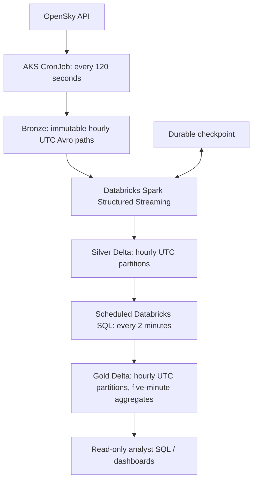

# Aviation Data Platform

An Azure lakehouse for OpenSky aircraft observations over Southeast Asia.

**Status: Foundation Terraform staged, not deployed.** The [architecture and technical design](references/thales-azure-data-platform-design.md) describes the target system; the [collector CLI, tests and Helm chart](ingestion/README.md) and [Bronze → Silver streaming Job and local tests](transformation/data-pipelines-design-doc.md#running-silver-local-and-provisioned) are implemented but not verified on AKS/ADLS/Databricks. Gold remains design-only. [Azure/Unity Catalog setup and recovery commands](infra/tf/README.md) require operator credentials and a reviewed plan.

## Architecture Diagram

## Architecture Decision

### Repository
The requirements initially suggest a monorepo. However, a monorepo may complicate team access control and CI/CD because every team must work within the same repository. At the same time, it provides valuable organization-wide visibility into the codebase.

To balance these trade-offs, I propose a polyrepo structure connected through Git submodules. Each team can independently manage its repository, permissions, and CI/CD pipelines, while a top-level repository provides a unified view of the overall system.

* Infrastructure code - [infra/tf](infra/tf)
* Ingestion code - [ingestion](https://github.com/jiminhsieh/aviation-data-scrapper)
* Transformation code - [transformation](https://github.com/jiminhsieh/aviation-data-pipeline)

### Data Platform

1. **Ingestion:** an AKS CronJob authenticates to OpenSky every 120 seconds for the fixed bounding box. It archives one immutable Snappy-compressed Avro container per response, preserving exactly the original `time` and positional `states` payload without added Bronze fields.
2. **Bronze → Silver:** native Spark Structured Streaming on Databricks classic Jobs compute uses a durable checkpoint and initially one-minute micro-batches. Each batch rereads complete affected Bronze hours, validates and deterministically deduplicates observations, then atomically replaces those Silver partitions with `replaceWhere`.
3. **Silver → Gold:** an independent SQL-file task runs every two minutes on a Pro or Serverless SQL warehouse. At PoC scale, it atomically overwrites all Gold data from retained Silver, including clearing obsolete hours. It is not coupled to the stream checkpoint; SQL failures do not block Silver.
4. **Governance and delivery:** Unity Catalog governs volumes, managed Delta tables and grants. Separate AzureRM and Databricks Terraform roots stage the foundation; the [collector Helm chart](ingestion/README.md#build-and-deploy) owns its Kubernetes objects and future Databricks Job definitions own the pipeline.

AKS provides controlled Kubernetes ingestion; Spark runs in Databricks, not on AKS. No Kafka, Airflow or Auto Loader is required. Avro small-file overhead and continuous Spark/SQL warehouse costs must be measured, not assumed to be lower.

### Data Lake

ADLS Gen2 uses two accounts: a primary account with `bronze`, `lakehouse` and `quarantine` (no blob soft delete), and a separate `checkpoints` account with 30-day blob soft delete. Bronze and checkpoints have separately governed Unity Catalog volumes; Silver and Gold are managed Delta tables.

| Layer | Hourly UTC layout |
|---|---|
| Bronze | `opensky/states/year=YYYY/month=MM/day=DD/hour=HH/<response.time>.avro` |
| Silver | Partitioned by `snapshot_hour_utc` |
| Gold | Partitioned by `bucket_hour_utc` |

All hour keys use source time and include the full UTC date. Hourly partitioning is a physical layout, not a one-hour processing delay. The freshness objective is **p95 <5 minutes** from source snapshot to queryable Gold, subject to measurement.

- **Silver key:** `(snapshot_time, icao24)`, where `snapshot_time` comes from source `time`.
- **Gold analytics:** five-minute UTC country buckets with aircraft counts and mean barometric altitude using each aircraft's latest non-null altitude within that bucket. `origin_country` is a registration-country proxy, not geographic overflight country.
- **History:** at least the trailing 24 hours after warm-up; initially retain approximately 30 days. A rolling 24-hour query can span 25 hourly partitions.

#### Data Access Permissions

| Identity | Bronze | Checkpoints | Silver | Gold | Secrets |
|---|---|---|---|---|---|
| Collector (AKS Workload Identity) | Create/read; collision handling | None | None | None | OpenSky names only |
| Silver stream (Databricks run-as) | Read | Read/write | Read/modify | None | None |
| Gold SQL (Databricks run-as) | None | None | Read | Read/modify | None |
| Data scientist | None | None | Read | Read | None |
| ATM analyst | None | None | Optional read | Read | None |

The collector also writes to quarantine; only the platform operator has recovery/teardown rights. Grants and cloud role-denial checks are not yet verified. [Full access matrix](references/thales-azure-data-platform-design.md#102-access-matrix).

### Security and Networking

Use separate least-privilege collector, Silver stream and Gold SQL identities, AKS Workload Identity, Key Vault and a Databricks Access Connector. Analysts need no storage keys or secrets; no static Azure storage credentials are used in the target design.

For the PoC, justify any public endpoints and verify AKS/Databricks connectivity without anonymous storage access. Production hardening includes private storage/Key Vault endpoints and DNS. Validate the supported Databricks serverless SQL networking configuration separately before restricting public storage access; an all-private deployment is not yet implemented.

## Runbook

- [Foundation first-run, state backup, rotation and teardown](infra/tf/README.md) — foundation only; review the plan before applying.
- [Collector local/AKS run, verification, Bronze contract and shared API budget](ingestion/README.md) — CLI/chart available; live verification outstanding. `*/2` UTC yields 720 polls × four = 2,880 daily credits; all retries, manual calls and environments share the remaining 1,120 credits (280 extra calls). Three live environments at that cadence would need 8,640 credits/day before retries. Source age/archival are separate from Silver and Gold freshness.
- [Silver local tests, first run, checkpoint restart and bounded replay](transformation/data-pipelines-design-doc.md#running-silver-local-and-provisioned) — code and paused Job available; hosted runtime verification outstanding.
- [Pipeline first-run checklist](references/thales-azure-data-platform-design.md#first-run-checklist) — Gold job is future work.

A second source can reuse the same environment, separate UC volume paths and run identities if quotas/grants permit; it needs its own collector contract, schema, retention and downstream jobs. Do not put another source in the OpenSky canonical prefix or reset its checkpoint.

