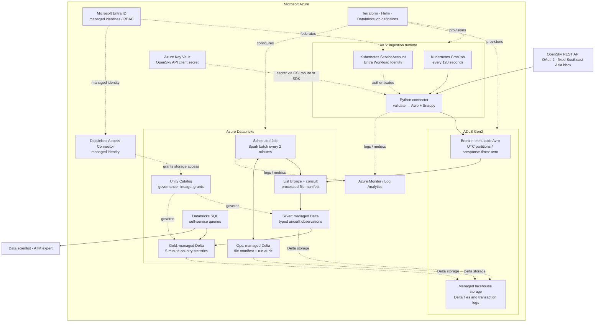
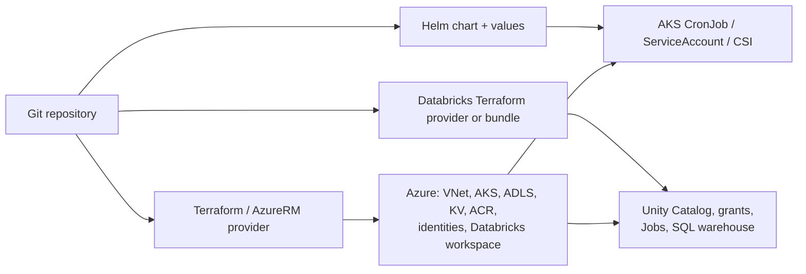
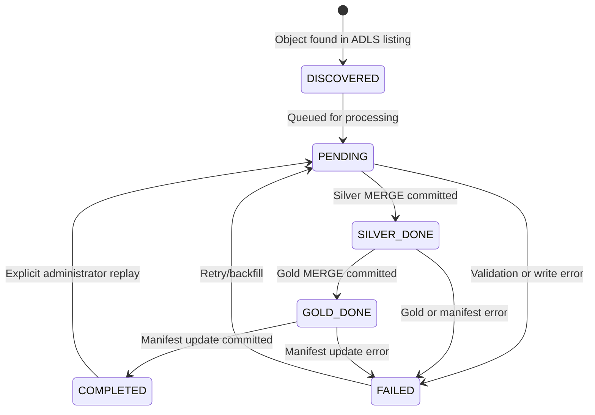
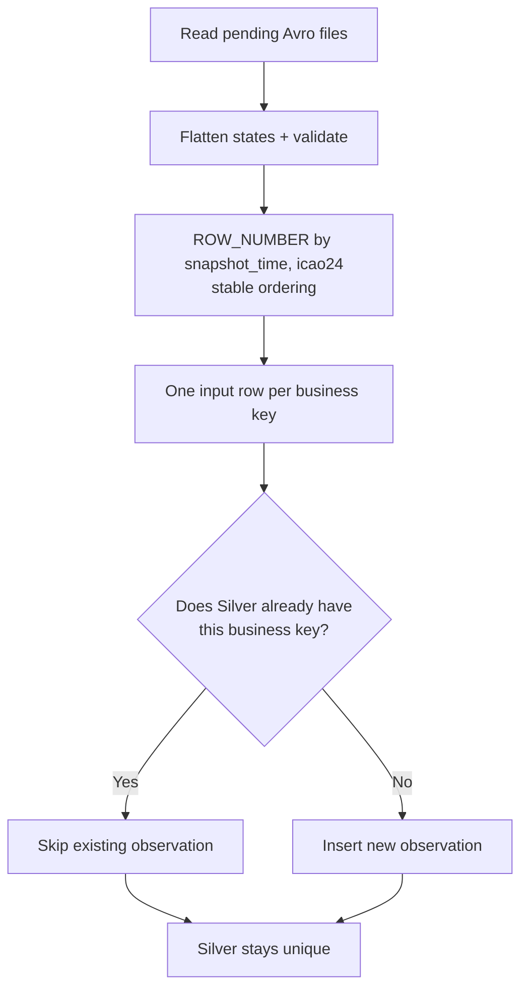
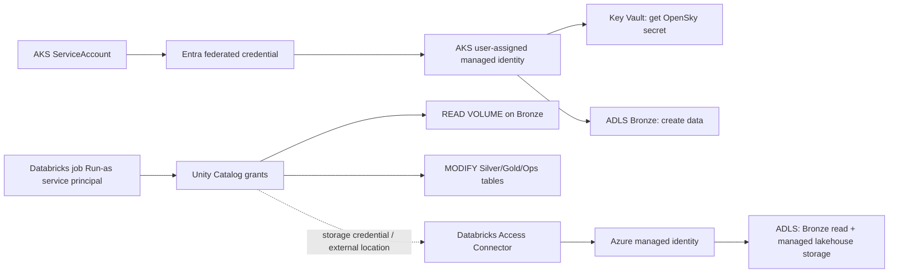

# Azure Aviation Data Platform — Architecture and Technical Design

**Target role:** Senior Data Infrastructure Platform Engineer (Thales Singapore)  
**Scenario:** OpenSky Network live aircraft observations over Southeast Asia  
**Document status:** Proposed design / take-home proof of concept  
**Version:** 1.0  
**Updated:** 2026-11-07  
**Primary stack:** Azure · AKS · ADLS Gen2 · Azure Key Vault · Azure Databricks · Delta Lake · Unity Catalog · Terraform · Helm  
**Processing model:** Scheduled ingestion and **scheduled Spark batch**; no file-arrival triggers, Event Grid, Auto Loader or continuously running streaming jobs.

---

## 1. Executive summary

Build a small, extensible aviation data platform using a **managed-first lakehouse with a Kubernetes ingestion runtime**:

1. An **AKS CronJob** calls the authenticated OpenSky API every **120 seconds** for the assignment's fixed bounding box.
2. The ingestion application converts each response into a **schema-defined, Snappy-compressed Apache Avro object**, retaining the information from the original response. It writes exactly one canonical Bronze object named **`<response.time>.avro`**, partitioned by the **UTC date of `response.time`**, to **ADLS Gen2**.
3. A **time-scheduled Azure Databricks Job** executes a conventional **Spark batch** every **two minutes**. It discovers unprocessed Avro objects through an explicit file manifest, not an event-based mechanism.
4. The job validates and flattens aircraft states, deduplicates on **`(snapshot_time, icao24)`**, and uses **insert-only Delta Lake `MERGE`** to write a managed **Silver** table.
5. In the same job, it recomputes the **affected five-minute time buckets** from Silver and upserts an aggregated managed **Gold** Delta table: aircraft counts and average barometric altitude by ICAO registration country.
6. Only after **both** table writes succeed does the job mark its input files **`COMPLETED`** in a Delta operational manifest. If processing fails, safe replay is possible.
7. **Unity Catalog** governs tables and ADLS paths; **Databricks SQL** gives data scientists and domain experts self-service queries. **Entra Workload ID**, **Azure Key Vault**, and a **Databricks Access Connector** supply credentials without embedding secrets in code.
8. **Terraform** provisions Azure and Databricks platform resources; **Helm** declares the AKS ingestion workload. One source-specific adapter and configuration file are the only substantial additions needed to onboard another similar REST source.

**Engineering thesis:** AKS demonstrates controlled, reusable source ingestion while Databricks provides managed compute, Delta transactions, governance, and SQL access. This is deliberately **not** a self-hosted Kafka/Airflow/Trino/Polaris platform. The design favors a working, repeatable vertical slice over operating unnecessary services for ~181,000 aircraft observations per day.

### In scope vs. deferred

| Area | PoC implementation | Production evolution |
|---|---|---|
| Ingestion | AKS CronJob; one OpenSky adapter | Additional adapters, contract-based onboarding, quotas per source |
| Bronze | Immutable Avro + Snappy on ADLS | Retention policy, archive tier, automated conflict review |
| Processing | Scheduled Databricks Spark batch | Workload isolation, dynamic scaling, faster incremental discovery |
| Silver/Gold | Unity Catalog-managed Delta tables | Data contracts, optimized layout, larger-scale incremental maintenance |
| Idempotency | Deterministic object names; manifest; Delta MERGEs | Audited replay, reconciler, conflict-specific incident workflows |
| Governance | Basic UC grants, data dictionary | Approval workflows, broader lineage/classification |
| Platform | Terraform, Helm, one AKS cluster | GitOps, policy-as-code, multi-tenant namespaces, standardized clusters |
| Security | Managed identities and Key Vault | Private endpoints, egress controls, hardened supply chain |
| Operations | Logs, key checks, simple alert policies | Formal SLO dashboard, incident response, upgrade testing |

**Source of requirements:** The supplied technical assessment asks for continuous live acquisition, near-original raw retention, typed/deduplicated data, a self-service 24-hour country/time aggregate, infrastructure reuse, a Terraform-based Git submission, trade-off analysis, and a 15–20-hour implementation budget. The supplied job description emphasizes Kubernetes, Terraform, operational control, Iceberg/Polaris/Trino, self-service and governance. This design intentionally substitutes Delta Lake/Unity Catalog/Databricks SQL for part of the JD's self-managed lakehouse stack; see [§15](#15-architecture-decisions-and-alternatives).

---

## 2. Requirements and assumptions

### 2.1 Functional requirements

| ID | Requirement | Proposed implementation |
|---|---|---|
| F1 | Poll live aircraft data automatically | AKS CronJob, every 2 minutes |
| F2 | Retain near-original raw data for audit/reprocessing | Full-fidelity typed Avro records, Snappy codec, immutable objects |
| F3 | Clean, queryable typed observations | Delta Silver table, validation, stable keys |
| F4 | Country activity over time, at least last 24 hours | Delta Gold table, 5-minute buckets |
| F5 | Self-service analyst access | Unity Catalog + Databricks SQL warehouse / notebook |
| F6 | Onboard future sources without rebuilding infrastructure | Generic Helm ingestion chart; source adapter/config; shared storage/catalog/job patterns |

### 2.2 Source contract

- **Base URL:** `https://opensky-network.org/api`
- **Endpoint:** `GET /states/all`
- **Bounding box (mandatory):** `lamin=-11`, `lamax=21`, `lomin=92`, `lomax=141`.
- **Authentication:** OpenSky OAuth2 client-credentials bearer token obtained using a registered API client.
- **API response:** A JSON object containing top-level integer **`time`** (Unix seconds) and **`states`**, a list of 17-element aircraft state vectors, or `null`.
- **Sampling basis specified in assessment:** ~252 aircraft and ~33 KB JSON per poll, with natural time-of-day variation.
- **Credits:** This bounding box costs **4 credits per request**. For a standard authenticated user, the documented allowance is **4,000 credits/day**. A 120-second schedule uses **720 requests/day × 4 = 2,880 credits/day**, leaving **1,120 credits/day** for recovery and validation. A 90-second schedule uses 3,840 and has a much smaller margin.
- **Source recovery limit:** OpenSky's standard authenticated live state endpoint allows historical queries only for approximately the past hour; long outages cannot necessarily be repaired from that endpoint. This is a real data-availability limitation, not a pipeline bug.

At 120-second polling, the stated example volume implies **~181,440 aircraft state records/day**, **~23.8 MB/day of uncompressed JSON**, and **~0.71 GB per 30 days** before compression (decimal units). Actual data volume and record counts will vary.

### 2.3 Non-functional objectives

| Dimension | Target / policy | Caveat |
|---|---|---|
| Freshness | **Target** p95 < 5 minutes from API snapshot time to queryable Gold | Must be measured; scheduled Databricks Jobs can start several minutes late, so this is **not guaranteed** by the schedule |
| Availability | No intentional loss of a successfully archived Bronze snapshot | Does not promise reconstruction of OpenSky snapshots missed during source/API outages |
| Recovery | Reprocess a Bronze object any number of times without extra Silver observations or inflated Gold aggregates | Depends on immutable inputs, deterministic rules, and serialized writers |
| History | At least trailing 24 hours of authentic observations once collected | New PoC requires a 24-hour warm-up or separately labeled synthetic fixtures for tests |
| Security | No static Azure storage credentials in pods or notebooks; least-privilege identities | Production networking and hardening partly deferred |
| Cost | Idle cost explicitly accounted for; no extra brokers or always-on Spark cluster by default | AKS nodes and SQL compute dominate at this data volume |
| Reusability | Add a second source through connector/config and source-specific transformation, not infrastructure duplication | Different source semantics still require engineering work |

**Important semantic decision:** OpenSky `origin_country` is **the country inferred from the aircraft's ICAO 24-bit transponder address**. It is **not** necessarily the country under the aircraft, its origin airport, or the country of its operator. The Gold table therefore measures activity by **ICAO registration country**; its description, query examples, and dashboard must say so.

---

## 3. High-level architecture



### Why these boundaries?

- **AKS** owns network-facing extraction, retry, rate-limit compliance, and durable delivery. It does not have direct write privileges to curated tables.
- **ADLS Bronze** is a durable, format-versioned handoff. The ingestion process does not synchronously invoke a Databricks Job.
- **Databricks** owns batch discovery, typed transforms, transactional Delta state, aggregates and self-service access.
- **Delta Lake** is the table format for **Silver, Gold and operational manifests**. The Bronze landing objects are **Apache Avro**, not Delta tables.
- **Unity Catalog** provides table/volume discovery, permissions, descriptions and lineage where available.
- **Scheduling is time-based at both ends**. There is **no file arrival trigger, event subscription, `readStream`, Auto Loader or streaming checkpoint**.

### Deployment and control-plane ownership



---

## 4. AKS ingestion service

### 4.1 Polling schedule and runtime

- Namespace: `data-ingestion`.
- One source-specific `CronJob`: `opensky-states-ingestion`.
- UTC schedule: `*/2 * * * *` (at even minutes).
- `concurrencyPolicy: Forbid` to prevent overlap within one CronJob; `backoffLimit: 1–2` and short total job deadline. Monitor missed schedules rather than launching uncontrolled retries.
- Prefer a single small application image, **Python + `requests`/`httpx` + `fastavro` + Azure SDK**.
- Container requests/limits, security context, non-root user, read-only root filesystem and pinned image versions/digests.
- Limit retries on network/5xx; **never retry `429` immediately**. Respect `X-Rate-Limit-Retry-After-Seconds`, daily credit consumption and a configurable request budget.
- Emit OpenSky snapshot timestamp, HTTP outcome, request duration, credit remainder, aircraft count, output path, checksum and ingestion status as structured metrics/logs.
- Handle empty or `states: null` snapshots: archive them, but do not create a fabricated aircraft record in Silver.

### 4.2 Authentication and secrets

The AKS Job uses **Microsoft Entra Workload ID** via its dedicated Kubernetes ServiceAccount to access:

1. **Key Vault:** read OpenSky `client_id` and `client_secret` (mounted by **Secrets Store CSI driver**, or retrieved by SDK using the same workload identity). Secrets are never printed or included in Terraform state.
2. **ADLS Gen2:** create the Avro object in the Bronze container. Prefer least-privilege permissions at the Bronze path; use storage RBAC/ACLs that support creation but not destructive operations where feasible.

AKS exchanges the OpenSky client credentials for an API bearer token. The OpenSky token is short-lived and remains in process memory; do not write it to a log or persistent file.

The **Databricks storage identity is separate** from the ingestion identity: Databricks gets access through a **Databricks Access Connector + Unity Catalog storage credential + external location**. Data scientists do not receive underlying storage-account keys.

### 4.3 Bronze Avro format

**One Avro object container file per OpenSky API response**, written with the **Snappy** codec. Encode a top-level record containing:

| Field | Avro type | Meaning |
|---|---|---|
| `time` | `long` | Original API response Unix timestamp; canonical snapshot key |
| `states` | nullable array of `AircraftState` | All original aircraft observations, represented by named fields |
| `schema_version` | `int` | Our mapping/schema version (metadata) |
| `payload_sha256` | `string` | Hash of the canonical JSON response before Avro encoding |
| `retrieved_at_utc` | logical timestamp | Fetch time (ingestion metadata; does not replace source time) |

`AircraftState` preserves **all 17 OpenSky positions in the documented order**, with nullable types where the source permits nulls:

| Index | Field | Suggested Avro type |
|---:|---|---|
| 0 | `icao24` | string |
| 1 | `callsign` | nullable string |
| 2 | `origin_country` | string |
| 3 | `time_position` | nullable long |
| 4 | `last_contact` | long |
| 5 | `longitude` | nullable double |
| 6 | `latitude` | nullable double |
| 7 | `baro_altitude` | nullable double |
| 8 | `on_ground` | boolean |
| 9 | `velocity` | nullable double |
| 10 | `true_track` | nullable double |
| 11 | `vertical_rate` | nullable double |
| 12 | `sensors` | nullable array of integer |
| 13 | `geo_altitude` | nullable double |
| 14 | `squawk` | nullable string |
| 15 | `spi` | boolean |
| 16 | `position_source` | integer |

The schema repository must include explicit index-to-name mapping and tests against sample API payloads. If the API introduces another field, treat it as a schema-contract change; don't silently truncate it.

**Near-original vs. byte-exact preservation:** The Avro record preserves source *values and meaning*, including nulls, but it is **not** byte-identical to the original JSON or its positional-array presentation. This satisfies a reasonable interpretation of the assignment's "original or near-original" requirement. If byte-for-byte evidence is later required, retain an additional compressed JSON object in a separate audit archive, with explicit extra storage cost. Do **not** claim lossless reconstruction of the exact original JSON bytes from the named-field Avro representation.

### 4.4 Deterministic object naming

Use the response's `time` field, not current wall-clock time, in the filename.

```text
abfss://bronze@<storage-account>.dfs.core.windows.net/
  opensky/states/
    year=2026/month=11/day=07/
      1794016200.avro
      1794016320.avro
      1794016440.avro
```

The example timestamps are illustrative. Derive the `year/month/day` partition keys from **`datetime.fromtimestamp(response['time'], timezone.utc)`**. This makes retries for the same source snapshot converge on the same path, including at midnight UTC.

**Collision policy:**

1. Require a valid integer `time` within configured sanity bounds; reject invalid responses into a separately named error/quarantine path.
2. Canonicalize the JSON structure and calculate its SHA-256 **before** serialization. An Avro file's binary bytes may differ across encodes due to container framing/sync markers; do not use a raw Avro-byte hash for semantic equality.
3. Use a conditional, **create-if-absent** object upload (`overwrite=False` / conditional `If-None-Match: *`), so parallel retries cannot overwrite an existing snapshot.
4. On "already exists", read its stored `payload_sha256`: **same hash ⇒ idempotent success**; **different hash ⇒ conflicting snapshot**. Archive the conflicting response under a `quarantine/conflicts/.../<time>-<hash>.avro` path, alert, and do **not** silently overwrite or send it to normal Silver processing.
5. If OpenSky returns the same `time` repeatedly, the ingestion Job may succeed with `already_exists`; record a **staleness metric** to distinguish no new observations from pipeline failure.

**Storage convention:** Never overwrite Bronze objects. Apply ADLS retention, access controls, and lifecycle policy separately. In production, decide whether WORM/immutability is needed; **do not** enable container-level WORM blindly on locations that Unity Catalog must manage and delete from.

### 4.5 Illustrative ingestion pseudocode

```python
from datetime import datetime, timezone
import hashlib
import json


def ingest_one_snapshot(api, blob_store, avro_serializer):
    response = api.get_states(
        lamin=-11, lamax=21, lomin=92, lomax=141
    )
    response_time = response.get("time")
    validate_response_and_timestamp(response)

    canonical_json = json.dumps(
        response, sort_keys=True, separators=(",", ":"),
        ensure_ascii=False
    ).encode("utf-8")
    digest = hashlib.sha256(canonical_json).hexdigest()
    date = datetime.fromtimestamp(response_time, timezone.utc)
    path = (
        f"opensky/states/year={date:%Y}/month={date:%m}/"
        f"day={date:%d}/{response_time}.avro"
    )

    record = map_full_response_to_avro(
        response,
        schema_version=1,
        payload_sha256=digest,
    )
    avro_bytes = avro_serializer(record, codec="snappy")

    try:
        blob_store.create_if_absent(path, avro_bytes)
        return {"status": "created", "path": path}
    except AlreadyExists:
        old_digest = blob_store.read_avro_metadata(path)["payload_sha256"]
        if old_digest == digest:
            return {"status": "already_exists", "path": path}
        blob_store.write_conflict(response_time, digest, avro_bytes)
        raise ConflictingSourceSnapshot(path)
```

This is *illustrative application logic*, not a complete Azure SDK implementation. The repository must include real SDK authentication, conditional upload, token refresh, exception handling, and serialization tests.

---

## 5. Storage, Unity Catalog and Delta Lake layout

Use one ADLS Gen2 account (hierarchical namespace enabled) with **separate storage containers or tightly separated paths**:

```text
ADLS Gen2 storage account
├── bronze/                         # Canonical immutable Avro (AKS writes)
│   └── opensky/states/year=.../
├── lakehouse/                      # UC managed Delta files and _delta_log
│   └── UC-managed layout (opaque to application)
└── quarantine/                     # Invalid or conflicting responses (restricted)
```

The Azure Databricks storage credential and external location expose the Bronze container as a **Unity Catalog external volume**, for example:

```text
/Volumes/aviation/bronze/opensky_states/
```

Do not make Databricks jobs depend on raw `abfss://...` account secrets. The processing service principal needs **`READ VOLUME`** on the Bronze volume plus appropriate table privileges. The managed Silver, Gold and Ops Delta tables use a Unity Catalog-managed storage location on the `lakehouse` container.

### Suggested catalog and schemas

```text
aviation
├── bronze.opensky_states          # External volume over Bronze Avro
├── silver.aircraft_states         # Managed Delta table
├── gold.aircraft_activity_5m      # Managed Delta table
└── ops.processed_files            # Managed Delta table
    ops.pipeline_runs              # Managed Delta table (optional)
```

**Operational caveat:** Unity Catalog **managed** tables have their lifecycle controlled by Unity Catalog; dropping one can remove its underlying data files. Avoid direct manipulation of `_delta_log` or UC-managed storage paths.

---

## 6. Scheduled Bronze → Silver → Gold processing (Option B)

This is a **finite batch job**, not event-driven ingestion or Structured Streaming.

### 6.1 Orchestration

- **Scheduler:** Databricks Job Scheduled trigger, UTC, **every 2 minutes**; optionally offset one minute after the AKS even-minute poll.
- **Execution engine:** Databricks Spark batch (`spark.read.format("avro")`).
- **Identity:** dedicated non-human **Run as** service principal with least-privilege Unity Catalog grants.
- **Maximum active runs:** **1** for this pipeline. If an interval is missed, the next successful run should drain the backlog. Monitor scheduler delays and queue behavior.
- **No** file-arrival job trigger, Event Grid, Auto Loader, `readStream`, `writeStream` or continuous Spark cluster required.
- **Stages of one logical job:** discover → read → normalize → deduplicate → merge Silver → recompute/merge Gold → mark files complete → emit audit metrics.

> **Freshness qualification:** Databricks states that its scheduler is not intended for strict low-latency execution and jobs can sometimes be delayed several minutes. A two-minute schedule is a *configuration*, not a contractual five-minute freshness guarantee.

### 6.2 Batch sequence

```mermaid
sequenceDiagram
    autonumber
    participant AKS as AKS CronJob
    participant OS as OpenSky API
    participant BR as ADLS Bronze Avro
    participant SCH as Databricks Scheduler
    participant MAN as Ops Delta Manifest
    participant SIL as Silver Delta
    participant GLD as Gold Delta

    AKS->>OS: GET /states/all (OAuth2, fixed bbox)
    OS-->>AKS: {time, states}
    AKS->>BR: CREATE <time>.avro (Snappy, no overwrite)
    Note over AKS,BR: Duplicate timestamp: verify hash or quarantine conflict
    SCH->>BR: List eligible UTC partitions / file paths
    SCH->>MAN: Read COMPLETED file keys
    MAN-->>SCH: Known processed paths and hashes
    SCH->>BR: Read pending Avro files via spark.read
    SCH->>SCH: Flatten, validate, deduplicate within batch
    SCH->>SIL: Insert-only MERGE (snapshot_time, icao24)
    SIL-->>SCH: Commit acknowledged
    SCH->>SIL: Query rows in affected 5-minute buckets
    SCH->>GLD: Recompute + MERGE affected country buckets
    GLD-->>SCH: Commit acknowledged
    SCH->>MAN: Mark processed file paths COMPLETED
    MAN-->>SCH: Manifest commit acknowledged
    Note over SCH,MAN: Failure before manifest commit => replay; MERGEs remain idempotent
```

### 6.3 Discovery without event triggers

Maintain a **Delta manifest** keyed by `(source_id, bronze_path)`; also retain response timestamp and hash.

```sql
CREATE TABLE IF NOT EXISTS aviation.ops.processed_files (
  source_id          STRING NOT NULL,
  bronze_path        STRING NOT NULL,
  source_time        BIGINT,
  payload_sha256     STRING,
  status             STRING,           -- PENDING / COMPLETED / FAILED
  attempt_count      BIGINT,
  first_discovered_at TIMESTAMP,
  completed_at       TIMESTAMP,
  last_run_id        STRING,
  error_message      STRING
)
USING DELTA;
```

The manifest is an **operational optimization**, not the sole correctness barrier. Delta tables do not automatically enforce uniqueness of the composite keys; ensure writers are serialized and monitor for duplicate manifest rows.

**Candidate selection strategy:**

1. List **current and previous UTC-day** Bronze partitions, including a configurable lookback (e.g., 48 hours). Directory listing is cheap at this scale and is performed on a schedule.
2. Add any manifest entries with `PENDING`/`FAILED` status, even if outside the ordinary lookback window.
3. Exclude `(source_id, bronze_path)` already marked `COMPLETED` **with the expected hash**.
4. Read candidates together as one Spark batch; cap candidate count if needed and process backlog in bounded chunks.
5. Reconcile all historical partitions on a **separate daily scheduled job** or in a manual backfill mode. A rolling lookback alone cannot guarantee detection of arbitrarily late files.
6. Never use a simple `MAX(source_time)` watermark by itself: it can miss late arrivals and manually restored old files.

To remain safe if registration of pending files fails, always derive the candidate set from **actual storage listing anti-joined against completed manifest rows**. Do not depend on a record having been registered in the manifest before it can be discovered.

### 6.4 Manifest state machine



For the lightweight PoC, `SILVER_DONE`/`GOLD_DONE` can remain **transient job states rather than durable manifest statuses**: mark `COMPLETED` only at the end. This avoids the complexity of inter-table transactions. If a failure occurs after Silver or Gold commits, rerun both idempotent MERGEs.

---

## 7. Silver data model, validation and deduplication

### 7.1 Logical table

```sql
CREATE TABLE IF NOT EXISTS aviation.silver.aircraft_states (
  snapshot_time        BIGINT NOT NULL,          -- OpenSky response.time (UTC epoch seconds)
  snapshot_at_utc      TIMESTAMP NOT NULL,
  bucket_start_utc     TIMESTAMP NOT NULL,      -- 5-minute bucket start
  icao24               STRING NOT NULL,
  callsign             STRING,
  origin_country       STRING,
  time_position        BIGINT,
  last_contact         BIGINT,
  longitude            DOUBLE,
  latitude             DOUBLE,
  baro_altitude_m      DOUBLE,
  geo_altitude_m       DOUBLE,
  on_ground            BOOLEAN,
  velocity_mps         DOUBLE,
  true_track_deg       DOUBLE,
  vertical_rate_mps    DOUBLE,
  squawk               STRING,
  spi                  BOOLEAN,
  position_source      INT,
  sensors              ARRAY<INT>,
  bronze_path          STRING,
  bronze_payload_hash  STRING,
  processed_at_utc     TIMESTAMP
)
USING DELTA;
```

No partitioning is necessary for the tiny PoC. At larger retention/volume, evaluate date clustering/partitioning, Delta optimization and selective pruning after measuring query profiles. Treat `snapshot_time` as the source's snapshot timestamp, not `last_contact` or the time the file was uploaded.

### 7.2 Quality rules

| Check | Behavior |
|---|---|
| Missing/invalid top-level `time` | Reject response at AKS; quarantine and alert |
| Duplicate `icao24` within one snapshot | Resolve deterministically and log |
| Invalid `icao24` (not six hexadecimal chars) | Quarantine observation / count invalid records |
| Latitude outside [-90, 90] or longitude outside [-180, 180] | Quarantine observation |
| Null optional position/altitude/callsign fields | Keep null; don't invent values |
| `origin_country` unavailable | Preserve nullable value; report as `Unknown` only in Gold presentation |
| Unexpected schema length or type | Quarantine source file; fail batch unless contract explicitly allows evolution |
| Malformed Avro | Mark failed; keep immutable original and alert |
| `states = null` or empty | Valid zero-record snapshot; mark Bronze file complete and retain run-level freshness evidence |

**Important:** A `states` array can contain two rows with the same `icao24` and snapshot time. Choose the row with greatest `last_contact`, then greatest `time_position`, then a stable content hash as the final tie-breaker. `dropDuplicates()` alone may choose an arbitrary survivor; for a defensible platform, use a deterministic `ROW_NUMBER` rule.

### 7.3 What counts as a duplicate?

**Business key = `(snapshot_time, icao24)`**, with `snapshot_time` taken from the top-level API `time`. An aircraft observed at 09:00 and again at 09:02 is **not** a duplicate: the two observations are necessary for historical analysis.

- **File dedup:** An immutable Bronze filename + a completed-file manifest avoids unnecessary file rereads.
- **Batch dedup:** Spark window selection ensures one row per business key inside an input batch.
- **Table dedup:** **Insert-only Delta `MERGE`** prevents replay from adding an observation already present in Silver.



### 7.4 Illustrative Spark batch code

```python
from pyspark.sql import functions as F, Window

# candidate_paths is a list of eligible Avro paths discovered from ADLS
bronze = spark.read.format("avro").load(candidate_paths)

flat = (
    bronze
    .select(
        F.col("time").cast("long").alias("snapshot_time"),
        F.col("payload_sha256").alias("bronze_payload_hash"),
        F.explode_outer("states").alias("aircraft"),
        F.col("_metadata.file_path").alias("bronze_path"),
    )
    .filter(F.col("aircraft").isNotNull())
    .select("snapshot_time", "bronze_payload_hash", "bronze_path", "aircraft.*")
)

validated = validate_and_normalize(flat)  # project-specific contract

ordering = Window.partitionBy("snapshot_time", "icao24").orderBy(
    F.col("last_contact").desc_nulls_last(),
    F.col("time_position").desc_nulls_last(),
    F.col("record_hash").desc(),
)

unique = (
    validated
    .withColumn("rank", F.row_number().over(ordering))
    .filter("rank = 1")
    .drop("rank")
)

unique.createOrReplaceTempView("incoming_aircraft_states")
```

`validate_and_normalize` must create `record_hash`, convert Unix timestamps into UTC timestamp columns, compute 5-minute bucket boundaries, and preserve values/units. The example uses Databricks file metadata to retain provenance; validate the runtime's metadata-column availability when implementing.

### 7.5 Silver insert-only MERGE

```sql
MERGE INTO aviation.silver.aircraft_states AS t
USING incoming_aircraft_states AS s
  ON t.snapshot_time = s.snapshot_time
 AND t.icao24 = s.icao24
WHEN NOT MATCHED THEN INSERT (
    snapshot_time, snapshot_at_utc, bucket_start_utc,
    icao24, callsign, origin_country, time_position, last_contact,
    longitude, latitude, baro_altitude_m, geo_altitude_m,
    on_ground, velocity_mps, true_track_deg, vertical_rate_mps,
    squawk, spi, position_source, sensors,
    bronze_path, bronze_payload_hash, processed_at_utc
) VALUES (
    s.snapshot_time, s.snapshot_at_utc, s.bucket_start_utc,
    s.icao24, s.callsign, s.origin_country, s.time_position, s.last_contact,
    s.longitude, s.latitude, s.baro_altitude_m, s.geo_altitude_m,
    s.on_ground, s.velocity_mps, s.true_track_deg, s.vertical_rate_mps,
    s.squawk, s.spi, s.position_source, s.sensors,
    s.bronze_path, s.bronze_payload_hash, current_timestamp()
);
```

The `MERGE` assumes the incoming batch contains **one row per business key**. Databricks documents that duplicate source rows should be removed before a MERGE because unmatched duplicate source records can both be inserted. Also, Delta Lake `MERGE` is **not** an automatically enforced unique constraint; serialize writes for the PoC and run a periodic duplicate-detection query.

**If a replay contains the same key with *different* values**, the insert-only policy leaves the existing Silver record unchanged and emits a conflict metric. A future correction/upsert policy must be explicitly defined with the domain owner; it should not be silently applied during ingestion.

---

## 8. Gold: five-minute country activity

### 8.1 Analytical interpretation

- **Grouping country:** OpenSky `origin_country` (ICAO registration-country proxy), not geographic overflight country.
- **Time bucket:** Fixed **five-minute UTC** interval, based on source `snapshot_time`.
- **Aircraft count:** Each distinct `icao24` contributes **once per bucket**. If an aircraft has multiple observations in the same five minutes, choose its **latest** snapshot in that bucket.
- **Average altitude:** Arithmetic mean of the **latest available non-null `baro_altitude_m`** for the selected aircraft records in each bucket. Null altitude is excluded. Report `altitude_sample_count` for interpretability.
- **Retention:** Keep at least 24 hours; initially retain 30 days or more for exploration, subject to a documented retention policy.

### 8.2 Managed Delta table

```sql
CREATE TABLE IF NOT EXISTS aviation.gold.aircraft_activity_5m (
  bucket_start_utc       TIMESTAMP NOT NULL,
  origin_country         STRING NOT NULL,
  aircraft_count         BIGINT NOT NULL,
  avg_baro_altitude_m    DOUBLE,
  altitude_sample_count  BIGINT NOT NULL,
  last_source_time       BIGINT,
  updated_at_utc         TIMESTAMP
)
USING DELTA;
```

### 8.3 Incremental Gold recomputation without event processing

For each scheduled batch:

1. Collect the set of **affected five-minute bucket starts** from the pending input files. This set exists even when all observations are skipped by an idempotent Silver MERGE.
2. Query **all Silver records belonging to those buckets** (not only the new batch).
3. Use a window to select the latest row per `(bucket_start_utc, icao24)`.
4. Aggregate by `(bucket_start_utc, origin_country)`.
5. **Upsert the recomputed aggregate using Delta `MERGE`** keyed on `(bucket_start_utc, origin_country)`; matched rows are **updated**, not incremented. Replaying the same input therefore leaves the counts unchanged.
6. Once **Silver and Gold commits** both succeed, mark the corresponding Bronze objects `COMPLETED` in the operational manifest.

Illustrative computation:

```sql
-- affected_buckets: temporary view with distinct bucket_start_utc
CREATE OR REPLACE TEMP VIEW recomputed_gold AS
WITH observations AS (
  SELECT s.*,
         ROW_NUMBER() OVER (
           PARTITION BY s.bucket_start_utc, s.icao24
           ORDER BY s.snapshot_time DESC, s.last_contact DESC,
                    s.bronze_payload_hash DESC
         ) AS rn
  FROM aviation.silver.aircraft_states s
  INNER JOIN affected_buckets b
     ON s.bucket_start_utc = b.bucket_start_utc
), latest_per_aircraft AS (
  SELECT * FROM observations WHERE rn = 1
)
SELECT
  bucket_start_utc,
  COALESCE(origin_country, 'Unknown') AS origin_country,
  COUNT(*) AS aircraft_count,
  AVG(baro_altitude_m) AS avg_baro_altitude_m,
  COUNT(baro_altitude_m) AS altitude_sample_count,
  MAX(snapshot_time) AS last_source_time
FROM latest_per_aircraft
GROUP BY bucket_start_utc, COALESCE(origin_country, 'Unknown');

MERGE INTO aviation.gold.aircraft_activity_5m AS t
USING recomputed_gold AS s
  ON t.bucket_start_utc = s.bucket_start_utc
 AND t.origin_country = s.origin_country
WHEN MATCHED THEN UPDATE SET
  t.aircraft_count        = s.aircraft_count,
  t.avg_baro_altitude_m   = s.avg_baro_altitude_m,
  t.altitude_sample_count = s.altitude_sample_count,
  t.last_source_time      = s.last_source_time,
  t.updated_at_utc        = current_timestamp()
WHEN NOT MATCHED THEN INSERT (
  bucket_start_utc, origin_country, aircraft_count,
  avg_baro_altitude_m, altitude_sample_count,
  last_source_time, updated_at_utc
) VALUES (
  s.bucket_start_utc, s.origin_country, s.aircraft_count,
  s.avg_baro_altitude_m, s.altitude_sample_count,
  s.last_source_time, current_timestamp()
);
```

**Recovery implication:** A failure after Silver commit but before Gold commit is safe. The file remains not completed; its next replay recomputes the same affected buckets from **Silver's full committed state**, then writes correct Gold values. A failure after Gold commit but before manifest commit is similarly safe because Gold uses **replacement values**, not `count = count + N`.

**Future correction handling:** If the platform later permits deleting or changing already-committed Silver observations, Gold's upsert-only path must additionally delete stale `(bucket, country)` groups that no longer exist. That is **out of scope** for the PoC's insert-only Silver contract.

### 8.4 Data scientist query

```sql
SELECT
  bucket_start_utc,
  origin_country,
  aircraft_count,
  ROUND(avg_baro_altitude_m, 1) AS avg_baro_altitude_m,
  altitude_sample_count
FROM aviation.gold.aircraft_activity_5m
WHERE bucket_start_utc >= current_timestamp() - INTERVAL 24 HOURS
ORDER BY bucket_start_utc DESC, origin_country;
```

Expose this via Databricks SQL editor, JDBC/ODBC, or a simple SQL dashboard. The data scientist can run queries without access to raw Azure storage or help from an engineer.

---

## 9. Failure recovery, idempotency and correctness

### 9.1 The end-to-end exactly-once *effect* claim

The platform should not claim end-to-end exactly-once transport. AKS and Databricks Jobs are retryable and **at-least-once processing** may occur. The goal is **effectively once-per-snapshot/aircraft in Silver and stable Gold aggregates**, using deterministic naming, immutable Bronze, explicit progress tracking and idempotent Delta writes.

| Failure / duplication mode | Preventive or recovery measure |
|---|---|
| AKS retries and fetches the same OpenSky snapshot | Filename `<response.time>.avro`, conditional create and hash comparison |
| Same timestamp, genuinely different response content | Conflict quarantine and alert; no silent overwrite |
| Same Bronze object discovered in multiple Spark runs | Completed-file manifest skips it on ordinary runs |
| Databricks batch restarted after partial Silver success | Insert-only Silver MERGE skips existing keys |
| Duplicate aircraft rows within a single batch | Deterministic Spark `ROW_NUMBER` per `(snapshot_time, icao24)` |
| Job fails after Silver but before Gold | Replay; recompute affected Gold buckets from current Silver |
| Job fails after Gold but before manifest update | Replay both MERGEs; counts are replaced, not incremented |
| Manifest lost/corrupted | Rebuild from Bronze object listing; replay all using idempotent MERGEs |
| Late-arriving old Bronze file | Rolling lookback + separate historical reconciler/backfill |
| Two Silver writers run simultaneously | Databricks `max_concurrent_runs=1`; operational prohibition on parallel backfill; handle Delta concurrency conflicts |
| Databricks service unavailable | AKS continues writing Bronze; next job drains backlog when service recovers |
| OpenSky unavailable for several hours | Flag irrecoverable live-data gap beyond API historical window; don't fabricate observations |
| Key Vault or ADLS unavailable | Ingestion fails visibly; do not report success or discard data silently |
| No aircraft in response | Bronze file is still archived and marked complete; update source snapshot audit watermark |

### 9.2 Monitoring queries

```sql
-- Should always return zero rows:
SELECT snapshot_time, icao24, COUNT(*) AS c
FROM aviation.silver.aircraft_states
GROUP BY snapshot_time, icao24
HAVING COUNT(*) > 1;

-- Should always return zero rows:
SELECT bucket_start_utc, origin_country, COUNT(*) AS c
FROM aviation.gold.aircraft_activity_5m
GROUP BY bucket_start_utc, origin_country
HAVING COUNT(*) > 1;
```

**Manifest invariant:** `COMPLETED` means **Silver merge committed + Gold recomputation/merge committed** for that source file. If a file contains zero valid observations, its successful archive/validation and the appropriate zero-row accounting still allow `COMPLETED`, while failures and quarantined rows remain visible in metrics.

### 9.3 Explicit replay/runbook

1. Identify the faulty batch, Bronze files and last successful Delta table versions.
2. Pause the scheduled Databricks Job and verify no active writer is running.
3. If Bronze is valid but Silver/Gold may be incomplete, change selected manifest entries from `COMPLETED` to `PENDING` or invoke explicit backfill mode for given paths. **Do not modify or overwrite Bronze Avro files.**
4. Run the scheduled batch implementation manually with the targeted file list; it performs idempotent Silver/Gold MERGEs.
5. Validate uniqueness, counts, affected buckets, file completion status and freshness.
6. Resume the schedule, document the incident and confirm no other source partitions were missed.

A full historical replay may be compute-intensive; allow bounds by source, date, and file count.

---

## 10. Security and access control

### 10.1 Identity flow



### 10.2 Access matrix

| Identity / persona | Bronze Avro | Silver Delta | Gold Delta | Ops Delta | Key Vault |
|---|---|---|---|---|---|
| AKS ingestion workload | Create/limited read for collision checks | None | None | None | Read specific OpenSky secret |
| Databricks batch job | Read via UC volume | Read + modify | Read + modify | Read + modify | None by default |
| Data scientist | None by default | Read | Read | None | None |
| ATM domain expert | None by default | Optional read | Read, SQL dashboard | None | None |
| Platform engineer | Recovery read, controlled replay | Operational manage | Operational manage | Operational manage | Manage via controlled role |

**Governance note:** The ATM expert should be able to inspect understandable table/column descriptions, limitations, owners and reliability indicators, without writing code. A basic SQL dashboard and documented data dictionary are sufficient for the PoC.

### 10.3 Azure networking

**PoC minimum:** one appropriately sized AKS node pool, controlled network access, ADLS and Key Vault access verified end-to-end, no broad public secret exposure, and clear justification for any public endpoints used to simplify the short exercise.

**Production target:**

- VNet/subnet separation for AKS; scoped network policies and outbound restrictions.
- Private endpoints for storage and Key Vault with correct Azure DNS configuration.
- An ACR integration with AKS, signed/verified image supply chain and vulnerability scanning.
- AKS OIDC issuer + Workload Identity; no shared Kubernetes static client secret for Azure auth.
- For **Databricks serverless compute**, use the supported **Network Connectivity Configuration (NCC)** and private endpoint workflow where required. Databricks serverless compute is not running in the AKS VNet. Ensure ADLS networking works from both AKS and Databricks before disabling public access.
- Key Vault logging and access review; secret rotation runbook.

Do not claim "everything is private" in the PoC unless private-link connectivity has actually been configured and tested.

---

## 11. Observability, SLOs and operations

### 11.1 Suggested indicators

| Signal | Source | Initial alert idea |
|---|---|---|
| Last successful API request | AKS structured logs/metric | No success for >6 minutes |
| Most recent **distinct** OpenSky `time` archived | Bronze metadata/audit | Source snapshot age >5 minutes |
| API credits remaining | OpenSky response headers | Budget projected to exhaust before quota reset |
| Ingestion failures and HTTP 429 count | AKS logs | Repeated failures or first prolonged 429 |
| Pending manifest file count / oldest pending age | Databricks Ops table | Backlog older than target freshness |
| Last successful Silver/Gold batch | Databricks Jobs | Failed or delayed scheduled run |
| Gold end-to-end source snapshot age | Gold plus Ops run watermark | p95 freshness over target |
| Invalid records / schema violations | Batch quality report | Sharp change from baseline |
| Duplicate business keys | SQL health query | Any nonzero result |
| SQL warehouse startup / idle hours | Databricks telemetry | Rising cost or unavailable query endpoint |

**Separate these latency measures:**

1. `API source age = fetched_at - response.time`.
2. `Landing latency = bronze_write_completed_at - response.time`.
3. `Silver latency = silver_committed_at - response.time`.
4. `Gold latency = gold_committed_at - response.time`.
5. `Serving freshness = now_utc - latest successfully represented source snapshot`.

When `states = []` or null, Gold has no new aircraft rows. Use the **Ops processed-snapshot watermark** to determine whether the platform remains healthy; don't mistake an empty-aircraft window for a processing outage.

### 11.2 Runbooks to include in the repo

- API `429` / exhausted credit budget: stop requests, respect retry-after, lower polling frequency if necessary; do not break provider quota.
- Failed Kubernetes Job: inspect pod logs and exit reason; distinguish API, Key Vault, network and ADLS failure.
- Databricks backlog: inspect file listing/manifest and Job state; avoid multiple writers; run bounded backfill.
- Bronze conflict: compare source hash, quarantine and investigate timestamp collision; avoid overwriting canonical snapshot.
- Delta table corruption or bad deployment: inspect table history and restore selectively as appropriate; never drop managed tables casually.
- Identity failure: verify Entra federation, Key Vault RBAC, storage role assignments, UC external location and Databricks Run-as privileges.

---

## 12. Terraform, deployments and repository structure

### 12.1 Terraform modules

| Module | Main resources / outputs |
|---|---|
| `resource-group` / `network` | Resource group, VNet/subnets, NSGs, optional private DNS/endpoints |
| `storage` | ADLS account with HNS, Bronze/quarantine/lakehouse containers, lifecycle configuration |
| `aks` | Cluster, one small node pool, OIDC issuer, Workload Identity, monitoring flags |
| `identity` | User-assigned managed identities, federated identity credential, RBAC scopes |
| `keyvault` | Vault, RBAC assignments, access scope; **not** secret values in Terraform state |
| `acr` | Registry and AKS pull permissions |
| `databricks-workspace` | Workspace and Azure Databricks Access Connector |
| `databricks-governance` | UC storage credential, external location, external volume, catalog, schemas, grants |
| `databricks-jobs` | Scheduled Spark batch job, Run-as, concurrency, cluster/serverless selection |
| `monitoring` | Log Analytics, diagnostic settings, alert rules where feasible |

Use a remote Terraform state backend with restricted permissions and locking; never commit state files or `.tfvars` containing secrets.

**Provisioning boundary:** AzureRM provisions cloud resources; the Databricks Terraform provider configures the workspace-level/UC resources after workspace availability; Helm deploys the AKS CronJob. Avoid circular bootstrap dependencies between identity, workspace and catalog provisioning.

### 12.2 Illustrative Kubernetes CronJob

```yaml
apiVersion: batch/v1
kind: CronJob
metadata:
  name: opensky-states-ingestion
  namespace: data-ingestion
spec:
  schedule: "*/2 * * * *"
  timeZone: "Etc/UTC"
  concurrencyPolicy: Forbid
  startingDeadlineSeconds: 60
  successfulJobsHistoryLimit: 2
  failedJobsHistoryLimit: 3
  jobTemplate:
    spec:
      backoffLimit: 1
      activeDeadlineSeconds: 90
      template:
        metadata:
          labels:
            azure.workload.identity/use: "true"
        spec:
          serviceAccountName: opensky-ingestion
          restartPolicy: Never
          containers:
            - name: ingestion
              image: <acr-name>.azurecr.io/opensky-ingestion:<version>
              resources:
                requests: {cpu: 50m, memory: 128Mi}
                limits: {cpu: 250m, memory: 256Mi}
              # Add SecretProviderClass CSI volume and config here.
```

The CronJob is an illustrative excerpt; actual repo includes ServiceAccount annotations, Secrets Store CSI mounts, SecretProviderClass, pod hardening, and release values. Kubernetes `timeZone` requires a compatible version; the production schedule must be unambiguously UTC.

### 12.3 Illustrative Databricks job configuration

```yaml
# Logical configuration: represent in Terraform or a Databricks bundle.
job:
  name: opensky-bronze-to-gold-batch
  run_as: spn-data-platform-processing
  schedule:
    timezone: UTC
    cron: "0 1/2 * * * ?"   # Quartz: odd minutes, offset from AKS even minutes
  max_concurrent_runs: 1
  task:
    entrypoint: databricks/jobs/process_opensky_batch.py
    source: /Volumes/aviation/bronze/opensky_states
    silver_table: aviation.silver.aircraft_states
    gold_table: aviation.gold.aircraft_activity_5m
    manifest_table: aviation.ops.processed_files
    lookback_hours: 48
```

Do not treat this illustrative YAML as a Databricks Bundles schema verbatim: implement it using the provider/bundle schema version pinned in the repository. Validate interval and Quartz expression in the actual workspace.

### 12.4 Repository layout

```text
aviation-data-platform/
├── README.md
├── Makefile
├── .gitignore
├── .env.example                      # Names only; no secrets
├── infra/
│   ├── modules/
│   │   ├── network/
│   │   ├── storage/
│   │   ├── aks/
│   │   ├── identity/
│   │   ├── keyvault/
│   │   ├── acr/
│   │   ├── databricks-workspace/
│   │   ├── databricks-governance/
│   │   └── monitoring/
│   └── environments/
│       └── dev/
│           ├── main.tf
│           ├── variables.tf
│           ├── outputs.tf
│           └── terraform.tfvars.example
├── platform/
│   └── helm/
│       └── ingestion-cronjob/
│           ├── Chart.yaml
│           ├── values.yaml
│           └── templates/
├── sources/
│   ├── common/
│   │   ├── api_client.py
│   │   ├── avro_writer.py
│   │   ├── bronze_storage.py
│   │   └── metrics.py
│   └── opensky/
│       ├── connector.py
│       ├── schema.avsc
│       ├── config.yaml
│       ├── Dockerfile
│       └── tests/
├── databricks/
│   ├── jobs/
│   │   ├── process_opensky_batch.py
│   │   └── reconcile_bronze.py
│   ├── sql/
│   │   ├── create_tables.sql
│   │   ├── merge_silver.sql
│   │   ├── merge_gold.sql
│   │   └── data_quality.sql
│   └── tests/
├── tests/
│   ├── fixtures/
│   └── integration/
└── docs/
    ├── architecture.md
    ├── decisions.md
    ├── cost-model.md
    ├── governance.md
    ├── operations.md
    └── showcase-script.md
```

The Git repository must contain the infrastructure, source code, SQL and all setup commands. The **only unavoidable manual input** is external OpenSky account/API-client registration and securely placing its secret in Key Vault; document commands/scripts for that bootstrap without putting the secret value in Terraform state.

---

## 13. Data platform self-service and governance

### 13.1 Data dictionary and ownership

| Dataset | Owner / steward | Consumer | Expected contents and quality |
|---|---|---|---|
| Bronze `opensky_states` volume | Platform engineering | Platform engineers / processors | Complete named-field mapping of source response; replayable, immutable; timestamp-based filename |
| Silver `aircraft_states` | Data engineering / ATM steward | Data scientist, optionally ATM expert | Typed observation per aircraft/snapshot, no duplicate business keys, nullable incomplete measurements |
| Gold `aircraft_activity_5m` | ATM domain steward + data engineering | Data scientist, ATM expert | 5-minute activity by **ICAO origin/registration country**, aircraft counted once/bucket, latest baro altitude mean |
| Ops `processed_files` | Platform engineering | Platform engineers only | Bronze processing progress, replay and error state |

Expose meaningful **table/column comments** in Unity Catalog, owner contact, source URL, snapshot meaning, nullability and limitations. The `origin_country` interpretation should be prominent. Provide one query template for the data scientist and a simple read-only visualization for the ATM expert.

### 13.2 Adding a second source

Reused unchanged: Azure storage account/container conventions, AKS cluster, Helm chart, shared authentication/Avro writer libraries, monitoring, Terraform identity module, Databricks workspace, UC catalog and SQL warehouse.

Per-source additions: connector adapter and endpoint config, API credentials, Avro schema, source-specific Bronze path, Silver model/keys and quality rules, Gold derivation, identity/grants as appropriate.

Example contract:

```yaml
source_id: opensky_states
source_type: rest_poll
poll_schedule: "*/2 * * * *"
bronze:
  format: avro
  compression: snappy
  filename_field: time
  path_prefix: opensky/states
processing:
  mode: scheduled_batch
  silver_table: aviation.silver.aircraft_states
  deduplication_keys: [snapshot_time, icao24]
```

The platform should **not** claim that adding a completely different source needs zero engineering. It removes repetitive provisioning while preserving a required source-specific adapter and schema contract.

---

## 14. Cost and scaling

### 14.1 Cost drivers at the assessment's volume

| Service | What is charged | Strategy |
|---|---|---|
| AKS | Worker VM hours, attached disks, network services; Free cluster-management tier still charges nodes | Minimal node pool; delete PoC resources when not needed |
| ADLS Gen2 | Data capacity, transactions, retrieval, redundancy | Small Avro files; measure compression; lifecycle policy |
| Azure Key Vault | Secret operations | Read once per CronJob or cache safely in job lifetime; do not optimize at security's expense |
| ACR | Registry tier/storage | Small image; remove unused images |
| Databricks Jobs | Job compute, startup, processing frequency | Short-lived job compute; benchmark 2-minute run schedule against startup overhead |
| Databricks SQL | Warehouse compute and auto-stop/idle time | Smallest appropriate warehouse, auto-stop, restrict usage |
| Azure Monitor | Log ingestion/retention | Structured compact logs, reasonable retention |
| Networking | Egress, NAT, private endpoints if deployed | Co-locate services in one Azure region, avoid unused premium network components |

**Budgeting placeholder, not a price quote:** plan for an always-on small AKS deployment to cost **hundreds of USD/month**, with **Databricks batch/SQL compute potentially comparable or larger** depending on the selected SKU, region and run frequency. The sub-1-GB/month raw storage bill is comparatively small. Before submitting a numerical cloud estimate, fill `docs/cost-model.md` with current Azure region/SKU rate-card values and measured Databricks DBUs. Do not represent an unmeasured total as an exact bill.

**Compression caveat:** At only ~33 KB JSON per poll, each Avro object stores schema/metadata overhead. **Avro + Snappy is not guaranteed smaller than JSON + Gzip**. Measure uncompressed JSON, gzipped JSON, Avro Snappy and Avro Deflate using the same representative payload. Avro is chosen for an explicit schema and compact typed encoding; report measured size reduction rather than assume one.

### 14.2 File counts and 100× growth

- **At 120 seconds:** **720 Avro files/day**, **~21,600 files/30 days**, **~262,800 files/year**, before retention.
- At 100× records (same polling cadence), aircraft records rise to ~18 million/day, but **file count remains 720/day** if the source returns larger snapshots. If 100× comes from more sources/higher frequency instead, file count and polling/API quotas rise too.
- New pressure points: wider Silver scans, Delta MERGE/shuffle cost, tiny-file accumulation in Delta, concurrency, storage listing and backlog, job run duration, SQL warehouse concurrency, and upstream API licensing.
- At this scale: benchmark partitioning/clustering, Delta `OPTIMIZE`, compaction and retention; consider source-level parallelism, dedicated workloads, and a more scalable ingestion/discovery mechanism where justified.
- **OpenSky quota is a hard external constraint.** Increasing polling by 100× is not possible on the standard 4,000-credit/day allowance just by scaling AKS.

---

## 15. Architecture decisions and alternatives

| Decision | Selected | Rejected/deferred | Reason / point at which to reconsider |
|---|---|---|---|
| Extractor runtime | AKS CronJob | Azure Functions, Container Apps | Meets JD's Kubernetes emphasis and enables reusable source adapters; switch if platform team cannot justify node/ops baseline |
| Landing format | Avro + Snappy | Original JSON, Gzip JSON | Schema-driven near-original records; validate actual compression overhead with a benchmark |
| Bronze filename | `response.time.avro` | Wall-clock UUID-only filename | Stable source-snapshot ID, cheap retry convergence; handle timestamp-content conflicts explicitly |
| Bronze→Silver scheduling | Databricks Scheduled Job + **Spark batch** | File-arrival trigger, Event Grid, Auto Loader, streaming | Explicit user choice; simple finite batch control and explainable retry semantics |
| File progress | Managed Delta manifest | Checkpointed Auto Loader | Transparent batch state; cost is writing discovery/recovery code |
| Silver correctness | Deduped batch + insert-only Delta MERGE | Blind append | Stable business-key idempotency on replay |
| Gold correctness | Recompute touched buckets + Delta MERGE update | Additive counters | Stable values despite retries; can repair partial processing |
| Table format | **Delta Lake** | Iceberg for this PoC | Native Databricks managed-table performance and ACID operations; JD explicitly favors Iceberg, so address interoperability/portability |
| Catalog | Unity Catalog | Polaris | Fully managed governance and permissions; switch if an Iceberg-native multi-engine catalog is a hard requirement |
| SQL engine | Databricks SQL | Self-managed Trino | Faster end-to-end PoC and simpler operations; consider Trino for existing K8s shared query platform or broad engine interoperability |
| Workflow | Databricks Jobs | Self-hosted Airflow | One small finite scheduled pipeline doesn't justify extra orchestration services; add for complex DAG dependencies, cross-platform workflows |
| Streaming platform | None | Kafka / Strimzi | REST polling source and low volume don't justify broker operational overhead; add for push event feeds or independent downstream consumers |
| Infrastructure delivery | Terraform + Helm | Fully manual portal setup | Reproducibility and infrastructure-as-code review |

**Interview positioning:** The JD mentions Kubernetes-native **Iceberg + Polaris + Trino** and the team may reasonably ask why you did not implement those. Explain that the assignment explicitly permits managed components; your deliberate choice spends the limited hours on a working source-to-analytics platform, AKS workload and identity fundamentals, Delta correctness, observability, and Terraform. Acknowledge the vendor lock-in and reduced direct experience operating stateful Kubernetes data engines. Describe when you would replace managed Databricks services with the team's established on-cluster stack.

---

## 16. Test strategy and acceptance criteria

### 16.1 Unit tests

- OpenSky 17-field positional-array → Avro record mapping, including nulls, empty arrays and `states: null`.
- UTC filename partitioning for normal times and day/month boundaries.
- Canonical JSON hash stability across key-order differences.
- Duplicate response `time` with same hash vs conflicting hash.
- Invalid coordinates, malformed ICAO codes, nullable altitudes/callsigns.
- Gold's latest-observation-per-aircraft-in-bucket semantics.

### 16.2 Integration tests

| Test | Steps | Expected result |
|---|---|---|
| Duplicate API snapshot | Attempt twice with same `time` and content | One canonical Bronze file; second is safe success |
| Conflicting source snapshot | Same `time`, different semantic payload | Canonical untouched, conflict quarantined, alert |
| Basic Bronze ingestion | Run AKS job | Avro file exists, readable and schema complete |
| Silver first load | Run Databricks batch | Valid typed observations inserted |
| File replay | Reset selected manifest status and rerun | Silver row count unchanged; no duplicate keys |
| Partial commit failure | Simulate failure after Silver but before Gold/manifest | Retry repairs Gold, marks complete, no inflated counts |
| Gold interpretation | Multiple polls with same aircraft in 5-min bucket | Aircraft counted once, latest altitude chosen |
| Empty source response | Archive `states = []` | Job completes, no fabricated Silver rows, watermark updated |
| Out-of-order Bronze file | Add old valid snapshot within lookback | Discovered and merged into correct old bucket |
| Old backfill | Add file outside lookback; run reconciler | File processed without relying on latest timestamp |
| Data scientist | Login as analyst and run SQL | Read Gold/Silver granted, no Bronze/ops privilege |
| Freshness | Run ≥1 hour and measure lags | Report p50/p95/max; document misses rather than claim unsupported SLO |

### 16.3 Showcase demo (90-minute format)

1. **Architecture (20 min):** Walk through diagram, cloud/k8s ownership, deliberate managed-vs-self-managed decisions, and why batch scheduling fits the source.
2. **Live demo (30 min):** Terraform resources and AKS CronJob; trigger/observe an OpenSky poll; inspect the deterministic Avro object; run the scheduled Spark batch; query Silver/Gold; replay a file and show no duplicate rows; show UC privileges and freshness metrics.
3. **Panel Q&A (30 min):** File conflicts, idempotent Delta MERGE, recovery after partial writes, API quota, source semantics, private networking, recurring compute costs, Iceberg/Trino alternative and second-source onboarding.
4. **Questions (10 min):** Ask about actual platform scale, existing AKS capabilities, preferred managed/self-managed boundaries and production SLO constraints.

**Acceptance criterion:** After collecting 24 hours of real data (or running a clearly labeled test fixture), an approved analyst can independently query country-by-five-minute aggregates covering the required window, while a replay test leaves Silver and Gold unchanged.

---

## 17. Practical implementation plan (15–20 hours)

| Day | Target time | Concrete output |
|---|---:|---|
| 1 | 3–4 h | Provision minimal Azure foundation (Terraform), test AKS→Key Vault→ADLS and UC→ADLS access; create empty Delta tables |
| 2 | 3–4 h | OpenSky OAuth2 connector, complete Avro schema, deterministic upload and collision handling, AKS CronJob |
| 3 | 4–5 h | Scheduled Databricks Spark batch, file discovery/manifest, deterministic Silver dedup, Delta MERGE |
| 4 | 3–4 h | Gold recomputation/Delta MERGE, SQL access/grants, failure and replay integration tests |
| 5 | 2–3 h | README, Mermaid diagrams, cost model, runbook, reproducible demo and trade-off notes |

**Minimum viable cut if time runs short:** Preserve the AKS→Bronze→Databricks Silver→Gold→SQL path and one replay/idempotency test; defer private networking, extensive monitoring, generic second-source framework and advanced optimization. Make every omission explicit in the README. The design is broader than the time budget; treat this schedule as a prioritization plan, not proof all infrastructure can be hardened in 20 hours.

### First-run setup checklist

1. Register an OpenSky API client manually with OpenSky (external prerequisite).
2. `terraform init/plan/apply` the Azure environment; record outputs, not secrets.
3. Use a documented secure bootstrap script to set OpenSky client credentials into Azure Key Vault **outside Terraform state**.
4. Build and push the ingestion image to ACR using repository commands; deploy Helm chart to AKS.
5. Apply UC storage credentials, external location, Bronze volume, catalog/schemas and Delta tables; assign the job service principal.
6. Deploy and enable the Databricks scheduled batch job in UTC.
7. Confirm Source → Bronze Avro → Silver Delta → Gold Delta → SQL with real source data.
8. Run replay and failure tests, collect cost/freshness measurements and **destroy the temporary Azure environment** after the showcase.

---

## 18. Explicit limitations / open questions

1. **Five-minute freshness is an objective, not an SLA.** Scheduled Databricks Job delays, startup overhead and batching can exceed the desired latency. Measure and consider a warmer runtime/faster scheduling if the data-science requirement is strict; quantify the increased spend.
2. **OpenSky API gaps can be unrecoverable.** The standard REST feed is not a historical source beyond its documented retrospective window. A production contract for full historical coverage needs a historical data service or a different source agreement.
3. **Avro is near-original, not exact JSON.** Explicitly state the preservation semantics and include schema evolution tests.
4. **Filename timestamp collision is possible.** Handle semantic hash conflicts rather than assuming `time` alone proves payload equality.
5. **Delta MERGE doesn't replace data validation or uniqueness enforcement.** Pre-dedup source batches, serialize writers, inspect conflicts, and test duplicate queries.
6. **The manifest and Silver/Gold are separate Delta transactions.** The ordering plus replay ensures convergence under failures, not a single atomic multi-table commit.
7. **Gold is by ICAO registration country**, not aircraft location. Validate that this matches the data scientist's intent; a geo-political country-overflight analysis needs geospatial enrichment.
8. **Databricks Delta/Unity Catalog differs from Thales' Iceberg/Polaris/Trino production stack.** Document how formats, access policies, table maintenance, cost and on-call ownership would change to integrate with that stack.
9. **Databricks serverless and private ADLS require network-specific configuration** beyond attaching AKS to a VNet.
10. **Monthly cost depends on selected SKUs and run frequency.** Use measured compute minutes and current regional rates; avoid assuming managed services are automatically cheaper.

---

## 19. References

### User-supplied basis

- `tech-challenge-sr-data-infra-platform-engineer.md` — scenario, quota/volume, 15–20-hour scope, requirements, deliverables, showcase expectations.
- `thales-data-infra-platform-engineer-jd.md` — Kubernetes-first infrastructure, Terraform/GitOps, lakehouse, data governance, self-service and operational maturity.
- `thales-data-platform-architecture.md` — earlier broad architectural reference, expanded/modified here for the user's selected managed-first implementation.

### Official external technical references (checked 2026-11-07)

- [OpenSky REST API: response, OAuth2, historical limit, credit tiers](https://openskynetwork.github.io/opensky-api/rest.html)
- [Azure Databricks: run jobs on a schedule and scheduling caveats](https://learn.microsoft.com/en-us/azure/databricks/jobs/scheduled)
- [Azure Databricks: read and write Avro files](https://learn.microsoft.com/en-us/azure/databricks/query/formats/avro)
- [Azure Databricks: Delta Lake MERGE and source deduplication](https://learn.microsoft.com/en-us/azure/databricks/delta/merge)
- [Azure Databricks: external locations and ADLS managed identities](https://learn.microsoft.com/en-us/azure/databricks/connect/unity-catalog/cloud-storage/external-locations-adls)
- [Azure Databricks: Unity Catalog managed vs. external assets](https://learn.microsoft.com/en-us/azure/databricks/data-governance/unity-catalog/managed-versus-external)
- [Azure Databricks: Run as service principal](https://learn.microsoft.com/en-us/azure/databricks/jobs/how-to/run-jobs-with-service-principals)
- [Azure Databricks: serverless compute networking and NCC](https://learn.microsoft.com/en-us/azure/databricks/security/network/serverless-network-security/)
- [Azure AKS: Key Vault CSI identity access](https://learn.microsoft.com/en-us/azure/aks/csi-secrets-store-identity-access)
- [Azure AKS: Free/Standard/Premium tier distinctions](https://learn.microsoft.com/en-us/azure/aks/free-standard-pricing-tiers)
- [Delta Lake: concurrency control](https://docs.delta.io/concurrency-control/)

---

**One-sentence design summary:** *A time-scheduled, Kubernetes-ingested aviation lakehouse on Azure: immutable source-timestamp-named Snappy Avro in ADLS, followed by idempotent Databricks Spark batch processing into Unity Catalog-managed Silver and Gold Delta tables, provisioned with Terraform and protected by managed identities and Key Vault.*
