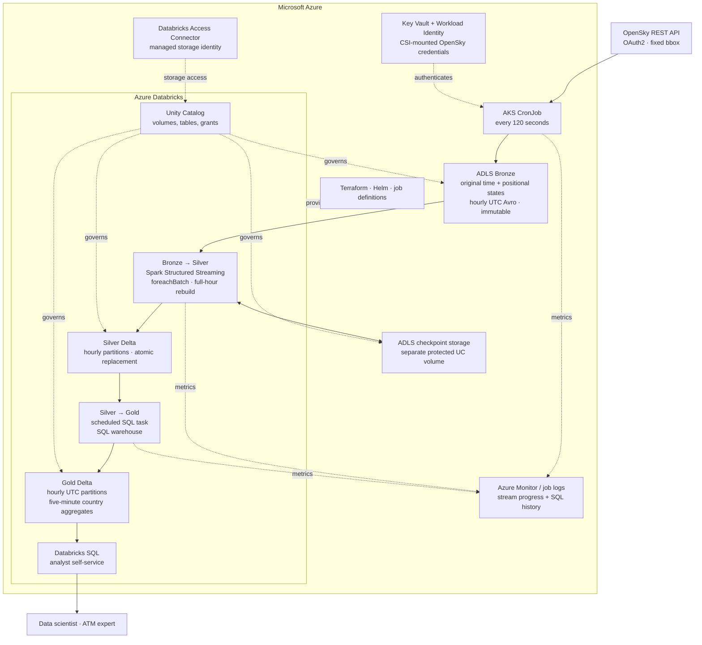

# Azure Aviation Data Platform — Architecture and Technical Design

**Target role:** Senior Data Infrastructure Platform Engineer (Thales Singapore)

**Scenario:** OpenSky Network live aircraft observations over Southeast Asia

**Document status:** Adopted design / implementation pending

**Version:** 1.4

**Updated:** 2026-11-09

**Primary stack:** Azure · AKS · ADLS Gen2 · Azure Key Vault · Azure Databricks · Delta Lake · Unity Catalog · Terraform · Helm

**Azure region:** `southeastasia` (Southeast Asia)

**Deployment environments:** `sit`, `uat`, `prod`

**Processing model:** Scheduled AKS ingestion → hourly Bronze Avro → Spark Structured Streaming → hourly Silver Delta replacement → scheduled Databricks SQL → hourly-partitioned Gold Delta.

---

## 1. Executive summary

Build a small, extensible aviation lakehouse with a Kubernetes ingestion runtime and **two independent transformation implementations**:

1. An **AKS CronJob** calls the authenticated OpenSky API every **120 seconds** for the assignment's fixed bounding box.
2. The collector writes one **Snappy-compressed Avro object container file per response** to ADLS Gen2. Its payload has exactly the original **`time` and `states`** structure, including positional aircraft arrays. There are **no added Bronze fields**.
3. Bronze objects use **`year=YYYY/month=MM/day=DD/hour=HH/<response.time>.avro`**, derived from the snapshot timestamp in **UTC**. Canonical objects are immutable.
4. A long-running **Spark Structured Streaming** query discovers new Bronze Avro files. Its `foreachBatch` callback rereads **all canonical files in each affected UTC hour**, decodes/validates/flattens observations, deduplicates **`(snapshot_time, icao24)`** and atomically replaces those **hourly Silver Delta partitions** with `replaceWhere`. No Silver MERGE is required.
5. An independent **scheduled Databricks SQL task**, executed on a **Pro or Serverless SQL warehouse**, refreshes managed **Gold Delta** country-by-five-minute aggregates from Silver, physically partitioned by **UTC hour**. It is not a PySpark Gold job or a streaming sink.
6. The stream uses a **durable checkpoint** for file progress. Gold uses a **single atomic SQL overwrite of its data**, recomputing all retained Silver at PoC scale. There is no processed-file manifest or joint Silver/Gold completion transaction.
7. **Unity Catalog**, managed identities, **Azure Key Vault**, and a **Databricks Access Connector** separate collection, transformation and analyst access. **Terraform** provisions the platform; **Helm** deploys the collector.

**Engineering thesis:** Use AKS for controlled extraction, ADLS as the durable handoff, Spark streaming for typed observations, and scheduled SQL for analytics. No Kafka, Airflow, Event Grid, file-arrival Job trigger or Auto Loader is required. This is a working vertical slice for roughly **181,000 observations/day**, not a self-hosted Kafka/Iceberg/Polaris/Trino platform.

| Area | PoC implementation | Production evolution |
|---|---|---|
| Ingestion | AKS CronJob; one OpenSky adapter | Additional adapters and source-specific quotas |
| Bronze | Immutable source-shaped Avro + Snappy; hourly UTC paths | Retention, archive tier, conflict review |
| Bronze → Silver | Structured Streaming; checkpoint; complete-hour rebuild + atomic partition replacement | Benchmark reread/rewrite cost, workload isolation and schema controls |
| Silver → Gold | Scheduled SQL; hourly UTC partitions; atomic full refresh from retained Silver | Incremental affected-bucket replacement when scans become expensive |
| Governance | UC grants, ownership, dictionary, read-only SQL | Approval workflows and broader lineage/classification |
| Platform | Terraform, Helm; environment-scoped deployments in `southeastasia` | GitOps, policy-as-code, multi-tenant isolation |
| Operations | Logs, stream progress, job history, replay checks | Formal SLOs, incident response and upgrade testing |

**Source of requirements:** The assessment requires live acquisition, near-original raw retention, typed/deduplicated observations, self-service country/time analytics over at least 24 hours, reusable Terraform infrastructure, trade-off analysis and a 15–20-hour implementation budget. The JD emphasizes Kubernetes, Terraform, Iceberg/Polaris/Trino, governance and operational control. The managed lakehouse substitution is deliberate; see [§15](#15-architecture-decisions-and-alternatives).

**Implementation boundary:** This document specifies the target design, not a deployed platform. The `ingestion/` and `transformation/` Git submodules currently contain READMEs and fixtures. Code, schemas, SQL, manifests and runnable setup commands remain to be implemented. Older root/infra READMEs and OpenSpec artifacts must be reconciled before implementation; they are not authoritative where they conflict with this design.

---

## 2. Requirements and assumptions

### 2.1 Functional requirements

| ID | Requirement | Implementation |
|---|---|---|
| F1 | Automatic live acquisition | AKS CronJob every two minutes |
| F2 | Near-original raw history | Original `time` / positional `states` structure encoded as immutable Avro |
| F3 | Clean, queryable observations | Typed Silver Delta, validation and stable business keys |
| F4 | Country activity over time | Hourly-partitioned Gold Delta, five-minute UTC buckets, at least 24 hours |
| F5 | Self-service analytics | Unity Catalog + Databricks SQL |
| F6 | Reusable platform | Shared Azure/AKS/lakehouse foundation, source-specific adapters and transforms |

### 2.2 Source contract

- **API:** `GET https://opensky-network.org/api/states/all`.
- **Mandatory bounding box:** `lamin=-11`, `lamax=21`, `lomin=92`, `lomax=141`.
- **Authentication:** registered OpenSky OAuth2 client credentials exchanged for a short-lived bearer token.
- **Response:** integer Unix-seconds `time` and `states`, which is null or a list of 17-element positional aircraft arrays.
- **Example volume:** approximately 252 aircraft and 33 KB JSON per poll, with time-of-day variation.
- **Quota:** 4 credits/request and 4,000 credits/day. The two-minute schedule uses **720 × 4 = 2,880 credits/day**, leaving **1,120 credits**, or at most **280 additional states requests**, for all retry layers and validation combined.
- **Environment quota scope:** quota and daily-volume figures describe one live collector. Running `sit`, `uat` and `prod` simultaneously at this cadence would consume **8,640 credits/day** before retries. If environments share the 4,000-credit daily allowance, budget all live collectors, retries and validation together; do not enable all three at this cadence against that shared allowance.
- **Recovery limit:** the standard authenticated live endpoint only supports a limited retrospective window, approximately one hour. Long source outages may produce irrecoverable gaps.

At this schedule the example implies **181,440 observations/day**, approximately **23.8 MB/day** and **0.71 GB/30 days** of uncompressed JSON, using decimal units. For assignment cost comparisons also show its stated **960 polls/day × 33 KB ≈ 0.95 GB/30 days** basis; do not mix the two schedules.

### 2.3 Non-functional objectives

| Dimension | Target / policy | Caveat |
|---|---|---|
| Freshness | Target p95 <5 minutes from source snapshot to queryable Gold | Polling, stream lag, SQL scheduling and warehouse startup all contribute; measure rather than infer from trigger intervals |
| Availability | No intentional loss of successfully archived Bronze | Missed upstream snapshots may not be recoverable |
| Recovery | Replays do not duplicate Silver or inflate Gold | Requires immutable inputs, deterministic rules and serialized writers |
| History | At least trailing 24 hours once collected | Requires warm-up; label synthetic test data explicitly |
| Security | No static Azure storage credentials; least privilege | Production networking/hardening partly deferred |
| Cost | Include idle AKS, **continuously running Spark**, and SQL warehouse spend | Streaming is a deliberate latency/operating-model choice, not a free optimization |
| Reusability | Add source adapters/transforms without duplicating the platform | Different source semantics still require engineering |

**Country meaning:** `origin_country` is an ICAO registration-country proxy, not the aircraft's current geographic country, origin airport or operator country. State this prominently in table comments and dashboards.

---

## 3. High-level architecture



### Boundaries and ownership

- **AKS** owns extraction, source retries/quota compliance and durable Bronze publication. It does not write curated tables or invoke a processing job.
- **Bronze** is an immutable, source-shaped Avro handoff. Schema definitions live in source control and Avro container headers; no extra schema/version/hash/fetch-time fields are added to the response record.
- **Spark** continuously discovers Bronze files under a stable root and owns only Silver writes. New files identify affected hours; Spark rereads each full Bronze hour and replaces only the matching Silver partitions. Its checkpoint advances after successful Silver processing, independently of Gold.
- **Databricks SQL** periodically reads a consistent Silver snapshot and owns only Gold writes. SQL failures must not block the Silver stream.
- **Delta Lake** stores Silver/Gold; **Unity Catalog** governs tables and volumes. Optional Ops audit tables support monitoring, not file discovery or correctness.
- **Terraform** provisions Azure/Databricks resources and grants; **Helm** deploys the CronJob. Jobs and SQL are deployed from version-controlled files, not portal-only configuration.

---

## 4. AKS ingestion service

### 4.1 Scheduling, runtime and quota

- Namespace `data-ingestion`; CronJob `opensky-states-ingestion`.
- UTC `*/2 * * * *`, `concurrencyPolicy: Forbid`, bounded pod/application retries and a short overall deadline.
- Small pinned Python image using an HTTP client, `fastavro` with Snappy support and the Azure SDK. Run non-root with requests/limits and a read-only root filesystem.
- Bound network/5xx retries; respect `X-Rate-Limit-Retry-After-Seconds` on `429`. Kubernetes retries and manual calls consume the same daily quota headroom.
- Log source/fetch times, outcome, duration, credits remaining when available, aircraft count and destination. Never log credentials or tokens.
- Archive valid empty/null `states` snapshots; zero observations is not an ingestion failure.

### 4.2 Authentication and permissions

A dedicated Kubernetes ServiceAccount uses **Entra Workload Identity** to mount specific OpenSky `client_id` / `client_secret` values from **Key Vault through Secrets Store CSI** and to access ADLS. Tokens remain in process memory. Secret values are injected outside Terraform state.

Scope storage access to Bronze creation/limited reads for collision checks and quarantine writes. Do not grant Silver/Gold access or distribute storage-account keys. The Databricks storage identity is separate, using an Access Connector and Unity Catalog storage credentials/external locations.

### 4.3 Bronze Avro contract

**One Snappy-compressed Avro object container file, containing one record, per API response.** Its only top-level fields are:

| Field | Meaning |
|---|---|
| `time` | Avro long; original source Unix timestamp |
| `states` | Null or an array of positional arrays, preserving the source structure and values |

**No enrichment fields and no named aircraft records in Bronze.** Operational metadata belongs in logs/checkpoints or downstream tables, not in the source payload.

Each aircraft array preserves these positions. Names are documentation and later Silver column names, not Bronze record fields:

| Index | Meaning | Source value type |
|---:|---|---|
| 0 | `icao24` | string |
| 1 | `callsign` | nullable string |
| 2 | `origin_country` | string |
| 3 | `time_position` | nullable integer timestamp |
| 4 | `last_contact` | integer timestamp |
| 5 | `longitude` | nullable number |
| 6 | `latitude` | nullable number |
| 7 | `baro_altitude` | nullable number, metres |
| 8 | `on_ground` | boolean |
| 9 | `velocity` | nullable number, m/s |
| 10 | `true_track` | nullable number, degrees |
| 11 | `vertical_rate` | nullable number, m/s |
| 12 | `sensors` | nullable array of integers |
| 13 | `geo_altitude` | nullable number, metres |
| 14 | `squawk` | nullable string |
| 15 | `spi` | boolean |
| 16 | `position_source` | integer |

Avro arrays have one item schema, so heterogeneous aircraft values require an **item union covering the permitted scalar types, null and the nested sensors array**. Validate the type at each position separately; the union alone cannot enforce the 17-position contract. Test integer/double/boolean handling without lossy coercion.

Decoding must reproduce the original JSON **structure and values**, including padded callsigns and nulls. Binary Avro does not preserve exact original JSON bytes/formatting. An unexpected source length/type is a contract failure, not permission to silently truncate. Schema evolution requires explicit producer/reader changes and compatibility tests.

### 4.4 Hourly object naming and collisions

```text
abfss://bronze@<storage-account>.dfs.core.windows.net/
  opensky/states/year=YYYY/month=MM/day=DD/hour=HH/<response.time>.avro
```

Derive **all four partition keys from `datetime.fromtimestamp(response['time'], timezone.utc)`**. Never use upload time or `last_contact`. The sample `1793013825` is `2026-10-26T11:23:45Z`:

```text
opensky/states/year=2026/month=10/day=26/hour=11/1793013825.avro
```

Approximately 30 snapshot files occupy an hour at normal cadence; hourly partitioning does not mean one combined/overwritten file per hour.

1. Validate the response and timestamp before canonical publication. Invalid original responses go to restricted quarantine and cause visible failure.
2. Publish the completed object atomically with **create-if-absent**, never exposing a partial final file. Use Azure SDK conditional publication semantics appropriate to the selected client; a preliminary existence check alone is not sufficient.
3. If the path exists, decode its single Avro record and compare `time` / `states` content with the incoming response. Do not compare binary Avro bytes, whose container framing can differ.
4. Identical content is idempotent success. Different content for the same timestamp is a conflict: preserve canonical Bronze, archive the conflicting original under a unique quarantine path, alert and fail. Quarantine is outside the watched canonical source root.
5. Track repeated timestamps separately from request success so stale source data is visible. Storage/quarantine/authentication failures produce nonzero exits; do not silently discard a response.

Bronze is never overwritten. Apply retention/access/lifecycle policies separately; do not blindly apply container-level WORM to UC-managed locations that must support table maintenance/deletion.

---

## 5. Storage, Unity Catalog and Delta Lake layout

```text
ADLS Gen2 account (hierarchical namespace enabled)
├── bronze/       opensky/states/year=.../month=.../day=.../hour=.../<time>.avro
├── checkpoints/  opensky/bronze_to_silver/   # durable stream progress; no automatic expiry
├── lakehouse/    UC-managed Delta layout, opaque to applications
└── quarantine/   restricted invalid/conflicting source data
```

Expose Bronze and checkpoint storage as separately governed UC volumes. Keep checkpoint paths separate from Bronze discovery and managed Delta table storage:

```text
aviation
├── bronze.opensky_states             # external volume over canonical source root
├── silver.aircraft_states            # managed Delta table, partitioned by UTC hour
├── gold.aircraft_activity_5m          # managed Delta table, partitioned by UTC hour
└── ops.streaming_checkpoints         # protected volume; stream identity read/write only
    ops.pipeline_runs                # optional audit Delta table, not a file manifest
```

Illustrative source root: `/Volumes/aviation/bronze/opensky_states/`. Checkpoint root: `/Volumes/aviation/ops/streaming_checkpoints/opensky/bronze_to_silver/`. Bootstrap the source directory before starting an explicit-schema stream, even if initially empty.

The stream principal needs `READ VOLUME` on Bronze, `READ VOLUME` / `WRITE VOLUME` on its checkpoint volume, and Silver read/modify grants. The SQL principal needs Silver read, Gold read/modify and warehouse use, but no Bronze/checkpoint access. Include UC catalog/schema usage grants.

**Managed-table caveat:** dropping a UC-managed table can delete its data. Do not directly manipulate its files or `_delta_log`. Gold refresh replaces **data in the existing table**, not its catalog object or grants.

---

## 6. Independent streaming and SQL execution

### 6.1 Bronze → Silver stream

- One Databricks Job with a **continuous Job trigger** maintains a long-running Structured Streaming query on **classic Jobs compute** with a pinned compatible runtime. Serverless Jobs compute does not support this processing-time trigger; a Serverless **SQL warehouse** for Gold is a separate supported choice.
- Use native `spark.readStream.format("avro")`, an **explicit Spark schema** matching the Avro reader representation, a stable source root, and a dedicated durable checkpoint.
- Use `recursiveFileLookup=true` to discover nested hourly directories and `pathGlobFilter=*.avro` to restrict inputs. Recursive lookup disables directory partition inference; derive time/bucket columns from payload `time`, not path columns.
- An initial **one-minute processing-time micro-batch trigger** is a tuning starting point, not a freshness guarantee. Bound files per trigger if needed after measuring backlog.
- This is **micro-batch execution**, not Spark's continuous-processing mode: `foreachBatch` requires micro-batches. A continuous **Job trigger** is a separate job-restart/control-plane setting.
- Enforce one active Silver writer. File discovery/checkpoint progress is handled by the native streaming source, not a completed-file manifest.
- **Hourly is the replacement scope, not a one-hour delay.** New files can refresh the current hour on each micro-batch. A batch spanning multiple hours rebuilds all of them, including earlier hours with late arrivals.

### 6.2 Silver → Gold SQL schedule

- A **separate Databricks Job SQL-file task** runs on a **Pro or Serverless SQL warehouse**. Initially schedule it every **two minutes in UTC**, configurable independently of the stream.
- Set one active Gold refresh and prevent overlapping manual writes. The SQL principal and compute are separate from the stream.
- At PoC volume, **recompute all retained Silver and atomically overwrite Gold data in one SQL statement**. This is the simplest complete late-arrival/retry strategy and removes obsolete country groups automatically.
- The refresh reads a consistent Silver snapshot; observations committed later appear in the next refresh. No shared checkpoint, file-completion ledger or cross-table transaction is required.
- At larger retention/volume, replace full scans with explicit changed-bucket discovery and **atomic replacement including stale-group deletion**. Do not add incremental bookkeeping before measurement justifies it.

### 6.3 Sequence and failure boundaries

```mermaid
sequenceDiagram
    participant AKS as AKS CronJob
    participant BR as Bronze Avro
    participant STR as Spark stream
    participant CP as Stream checkpoint
    participant SIL as Silver Delta
    participant SQL as Scheduled SQL warehouse task
    participant GLD as Gold Delta
    AKS->>BR: Conditional publish <time>.avro under UTC hour
    STR->>BR: Discover new eligible files
    STR->>STR: Identify affected UTC hours before flattening
    STR->>BR: Reread all canonical files in those hours
    STR->>STR: Decode, validate and deduplicate complete hours
    STR->>SIL: Atomic replaceWhere for affected hourly partitions
    SIL-->>STR: Commit acknowledged
    STR->>CP: Commit stream progress
    Note over STR,CP: Failure before progress commit may replay the micro-batch
    SQL->>SIL: Read retained observations on SQL schedule
    SQL->>GLD: Atomic INSERT OVERWRITE of recomputed aggregates
    Note over SQL,GLD: SQL failure leaves prior Gold visible; retry independently
```

### 6.4 Checkpoint and file-source rules

- Each query has its own protected, persistent checkpoint path. Preserve it across ordinary restarts and code deployments compatible with its source/state schema.
- Do not overwrite source files, change the watched root or discard the checkpoint casually. A fresh checkpoint may rediscover existing files; complete-hour replacement makes replay converge without duplicate observations.
- Source age filters, file modification times and checkpoint compatibility affect discovery. Do not assume timestamp directory names alone guarantee arbitrarily old restored files will be consumed.
- Normal newly landed files in earlier hours must be tested. For explicit historical replay, pause the stream and rebuild the complete Bronze hours containing the selected paths through the same Silver transformation/replacement, then refresh Gold and resume the original checkpoint. Never overwrite an hour from only selected snapshot files.
- No event-time watermark is used to discard old observations in the PoC. Retain historical observations needed for replay/analysis; do not deduplicate by aircraft ID alone.

---

## 7. Silver data model, validation and deduplication

### 7.1 Logical table

```sql
CREATE TABLE IF NOT EXISTS aviation.silver.aircraft_states (
  snapshot_time        BIGINT NOT NULL,
  snapshot_at_utc       TIMESTAMP NOT NULL,
  snapshot_hour_utc     TIMESTAMP NOT NULL,
  bucket_start_utc      TIMESTAMP NOT NULL,
  icao24               STRING NOT NULL,
  callsign             STRING,
  origin_country       STRING,
  time_position        BIGINT,
  last_contact         BIGINT,
  longitude            DOUBLE,
  latitude             DOUBLE,
  baro_altitude_m       DOUBLE,
  geo_altitude_m        DOUBLE,
  on_ground            BOOLEAN,
  velocity_mps         DOUBLE,
  true_track_deg       DOUBLE,
  vertical_rate_mps    DOUBLE,
  squawk               STRING,
  spi                  BOOLEAN,
  position_source      INT,
  sensors              ARRAY<INT>,
  bronze_path          STRING,
  processed_at_utc     TIMESTAMP
)
USING DELTA
PARTITIONED BY (snapshot_hour_utc);
```

Silver may add typed/derived columns and provenance; the no-extra-fields rule applies to **Bronze**. `snapshot_time` comes from top-level `time`. Configure `spark.sql.session.timeZone=UTC` and the SQL session timezone as UTC. Compute hour epoch seconds as `floor(snapshot_time / 3600) * 3600` and five-minute bucket seconds as `floor(snapshot_time / 300) * 300`, then convert to timestamps. Preserve original units and name them explicitly. Trim callsigns in Silver, not Bronze.

**All three layers use hourly UTC partitioning:** Bronze uses `year/month/day/hour` paths, Silver uses `snapshot_hour_utc` for complete-hour replacement, and Gold uses `bucket_hour_utc` (see §8.2). Both table hour keys include the full UTC date, not just hour-of-day. Create these layouts during bootstrap; changing an existing table's partitioning requires a controlled migration, not runtime schema overwrite.

### 7.2 Quality and duplicate rules

| Check | Behavior |
|---|---|
| Missing/invalid source timestamp | Collector quarantines; stream also fails closed if encountered |
| Invalid `icao24` (not six hex characters), out-of-bounds coordinates | Reject/count with Bronze file and row provenance in restricted logs; original remains in Bronze for recovery |
| Null optional position/altitude/callsign | Keep null; no invented measurements |
| Missing country | Preserve null; label `Unknown` only in Gold |
| Unexpected state length/type or malformed Avro | Fail visibly, alert, preserve original; no silent skip |
| `states = null` or empty | Valid zero-row snapshot; record processing/source freshness outside the Bronze payload |
| Duplicate `(snapshot_time, icao24)` across the complete rebuilt hour | Greatest `last_contact`, then `time_position`, then stable observation-content hash |

The tie-break hash is transient transformation logic, not a required Bronze field. Normalize/validate before constructing it. Persist rejection counts/provenance without logging whole payloads; do not acknowledge a batch if this required accounting fails. Label counts with batch/hour scope: full-hour rereads can count the same rejection again and are not newly acquired observations. The read-only stream does not rewrite or move rejected source records; original Bronze remains the recovery evidence.

**Business key:** `(snapshot_time, icao24)`. The same aircraft in different polls is history, not a duplicate. Use deterministic `ROW_NUMBER`, not arbitrary `dropDuplicates()` selection.

### 7.3 Avro union decoding

Spark can expose complex Avro unions as structs with branch members rather than native heterogeneous Python arrays. The 17 positional elements must be decoded from the **actual pinned runtime's union representation** before index-to-column mapping. Do not use `aircraft.*`, assume a named aircraft record, cast every branch to string, or read nonexistent Bronze enrichment fields.

Test the real producer schema through the selected Spark Avro reader, including long/double/boolean values, nulls, the nested sensors array, and empty snapshots. An Avro reader schema option is not a substitute for the Spark `StructType` required by native file streaming. Pin and test reader options alongside the schema; union branch changes are not automatic safe evolution.

### 7.4 Illustrative stream shape

```python
# Illustrative shape only: schema and callback must be implemented/tested.
bronze = (
    spark.readStream.format("avro")
    .schema(bronze_spark_schema)
    .option("recursiveFileLookup", "true")
    .option("pathGlobFilter", "*.avro")
    .load(bronze_volume_path)
)

query = (
    bronze.writeStream
    .foreachBatch(process_silver_microbatch)
    .option("checkpointLocation", checkpoint_path)
    .trigger(processingTime="1 minute")
    .start()
)
query.awaitTermination()
```

`process_silver_microbatch(batch_df, batch_id)` uses the incoming batch to select **hours**, not as the complete replacement data:

1. Validate top-level source timestamps and derive distinct affected UTC hours **before exploding `states`**, so null/empty snapshots still identify their hour. A genuinely empty incoming batch has no affected hours and needs no write.
2. Use a batch Avro read with the same schema to reread **all canonical snapshot files** under each affected `year/month/day/hour` directory. Include previous files, not only the newly discovered paths. Fail on missing/unreadable inputs; never turn a read error into an empty replacement. Validate payload timestamps against the requested directories.
3. Decode/flatten/validate the full-hour inputs, derive UTC hour/bucket columns, attach actual reread-file provenance and deterministically deduplicate per business key. Capture metadata before flattening; verify `_metadata.file_path` on the pinned runtime.
4. Validate the rebuilt schema and hour scope, then issue **one atomic partition-scoped write covering all affected hours**. Record successful source freshness and zero-row/invalid counts after processing; propagate failures before checkpoint acknowledgement. Gold is not called here.

### 7.5 Idempotent hourly Silver replacement

`rebuilt_hours` contains complete normalized observations from all affected hours, matching the target schema with one row per business key. `hour_predicate` explicitly selects those hours, for example `snapshot_hour_utc IN (TIMESTAMP '2026-10-26T11:00:00Z', TIMESTAMP '2026-10-26T12:00:00Z')`.

```python
(
    rebuilt_hours.write.format("delta")
    .mode("overwrite")
    .option("replaceWhere", hour_predicate)
    .saveAsTable("aviation.silver.aircraft_states")
)
```

Keep `replaceWhere` constraint checking enabled; all output rows must belong to the selected hours. Preserve the existing table, grants and schema. Never use an unscoped whole-table overwrite, separately committed delete/insert, or the incoming micro-batch alone as replacement data. Do not enable uncontrolled schema evolution.

An affected hour with **zero valid observations** still needs a schema-correct empty replacement, clearing any old rows for that hour. Do not skip the write merely because `rebuilt_hours` is empty. Dynamic partition overwrite is not used: an empty result cannot identify a partition to clear.

Keep canonical Bronze for at least the retained Silver/rebuild horizon. Do not rebuild from an expired, partially deleted or incompletely restored hour; restore its complete source first. Missing source is a failure, not evidence of zero aircraft.

`foreachBatch` is **at-least-once**: after a commit-before-checkpoint failure, reread and replace the full affected hours again. Unchanged Bronze and rules produce the same Silver **business rows** without duplicate keys; `processed_at_utc` may change. Newly landed files can be included in the next rebuild. Serialize stream/backfill writers and run duplicate checks; the checkpoint tracks discovery, while full-hour replacement provides result idempotency.

---

## 8. Gold: scheduled Databricks SQL country activity

### 8.1 Analytical meaning

- **Country:** latest selected observation's `origin_country`, normalized to `Unknown` if missing/blank; registration-country proxy, not geographic overflight country.
- **Bucket:** five-minute UTC interval derived from source snapshot time.
- **Partition:** `bucket_hour_utc`, the full UTC hour containing `bucket_start_utc`. Physical hourly partitioning does not change five-minute aggregation, the refresh schedule or retained history.
- **Aircraft count:** each `icao24` counts once per bucket, using its latest observation in that bucket.
- **Altitude:** mean of each counted aircraft's **latest non-null barometric altitude within the same bucket**, in metres. It may come from an earlier observation than the selected latest row. No carry-forward across buckets; exclude aircraft without any altitude in the bucket and report `altitude_sample_count`.
- **History:** at least 24 hours after collection; initially retain approximately 30 days or more subject to policy. Refresh all retained Silver, not just a hard-coded recent window.

### 8.2 Managed Delta table

```sql
CREATE TABLE IF NOT EXISTS aviation.gold.aircraft_activity_5m (
  bucket_hour_utc        TIMESTAMP NOT NULL,
  bucket_start_utc       TIMESTAMP NOT NULL,
  origin_country         STRING NOT NULL,
  aircraft_count         BIGINT NOT NULL,
  avg_baro_altitude_m    DOUBLE,
  altitude_sample_count  BIGINT NOT NULL,
  last_source_time       BIGINT,
  updated_at_utc         TIMESTAMP
)
USING DELTA
PARTITIONED BY (bucket_hour_utc);
```

Derive `bucket_hour_utc = DATE_TRUNC('HOUR', bucket_start_utc)` with the SQL session timezone set to UTC. This matches the source-time hour used by Bronze and Silver. Bootstrap Gold with this partition layout; `CREATE TABLE IF NOT EXISTS` will not migrate an existing unpartitioned table.

### 8.3 Atomic SQL refresh

Deploy this derivation as a SQL file task, not a Spark notebook. The following single statement recomputes the retained history and replaces **only the existing Gold table's data**:

```sql
INSERT OVERWRITE TABLE aviation.gold.aircraft_activity_5m
WITH observations AS (
  SELECT
    bucket_start_utc, icao24, origin_country, snapshot_time,
    ROW_NUMBER() OVER (
      PARTITION BY bucket_start_utc, icao24
      ORDER BY snapshot_time DESC
    ) AS latest_rank,
    FIRST_VALUE(baro_altitude_m) IGNORE NULLS OVER (
      PARTITION BY bucket_start_utc, icao24
      ORDER BY snapshot_time DESC
      ROWS BETWEEN UNBOUNDED PRECEDING AND UNBOUNDED FOLLOWING
    ) AS latest_non_null_altitude_m
  FROM aviation.silver.aircraft_states
)
SELECT
  DATE_TRUNC('HOUR', bucket_start_utc) AS bucket_hour_utc,
  bucket_start_utc,
  COALESCE(NULLIF(TRIM(origin_country), ''), 'Unknown') AS origin_country,
  COUNT(*) AS aircraft_count,
  AVG(latest_non_null_altitude_m) AS avg_baro_altitude_m,
  COUNT(latest_non_null_altitude_m) AS altitude_sample_count,
  MAX(snapshot_time) AS last_source_time,
  CURRENT_TIMESTAMP() AS updated_at_utc
FROM observations
WHERE latest_rank = 1
GROUP BY bucket_start_utc,
         COALESCE(NULLIF(TRIM(origin_country), ''), 'Unknown');
```

A single Delta overwrite is atomic: readers see the previous or new committed data, not an intermediate empty/partial table. Use **whole-table overwrite semantics across all hourly partitions**, not dynamic partition overwrite: an hour absent from the refreshed result must not retain stale Gold rows. A successful refresh against genuinely empty Silver intentionally yields empty Gold. Do not implement replacement as separately committed `DELETE` followed by `INSERT` or by dropping/recreating the table.

Full recomputation fixes late historical observations and removes obsolete country groups, including an aircraft moving from `Unknown` to a known registration country within a bucket. An upsert-only aggregate MERGE would leave vanished groups behind even when source observations are only added.

SQL refreshes are independent of stream checkpoint advancement. If a refresh fails, keep serving previous Gold, alert and rerun the SQL task. A later refresh converges from current Silver. Retries preserve **business aggregates**; `updated_at_utc` legitimately changes. Measure scan/warehouse cost before adopting incremental affected-bucket processing.

### 8.4 Analyst query

```sql
SELECT bucket_start_utc, origin_country, aircraft_count,
       ROUND(avg_baro_altitude_m, 1) AS avg_baro_altitude_m,
       altitude_sample_count
FROM aviation.gold.aircraft_activity_5m
WHERE bucket_hour_utc >= DATE_TRUNC('HOUR', CURRENT_TIMESTAMP() - INTERVAL 24 HOURS)
  AND bucket_start_utc >= CURRENT_TIMESTAMP() - INTERVAL 24 HOURS
ORDER BY bucket_start_utc DESC, origin_country;
```

The hour predicate enables partition pruning; the bucket predicate preserves the exact rolling 24-hour cutoff. A rolling window can overlap 25 UTC-hour partitions. Hourly partitioning does not imply one-hour processing latency or automatic 24-hour retention.

Expose through Databricks SQL editor, JDBC/ODBC or a basic read-only dashboard. Analysts need no underlying Azure storage keys or engineering help to execute the query.

---

## 9. Recovery, idempotency and correctness

### 9.1 Effectively-once results, not exactly-once transport

| Failure / duplication | Recovery |
|---|---|
| Collector receives identical source snapshot twice | Conditional create; compare decoded content; one canonical object |
| Same source timestamp, different content | Quarantine conflict; do not overwrite canonical Bronze |
| Stream restart | Resume the existing durable checkpoint |
| Silver commit succeeds, callback/checkpoint fails | Replay rereads and atomically replaces complete affected hours; no duplicate business keys |
| Duplicate aircraft in an affected hour | Deterministic per-key survivor across the full hour before replacement |
| New/late file in an existing hour | Reread the complete Bronze hour; preserve earlier snapshots and replace only that Silver hour |
| Rebuilt hour has zero valid observations | Explicit empty replacement clears that hour; unrelated hours remain |
| Complete Bronze hour unavailable | Stop before replacement; restore source completeness, never overwrite from a partial subset |
| Gold task fails or is delayed | Silver continues; retry independent atomic SQL refresh |
| Stream is unavailable | Collector continues landing Bronze; recover/drain eligible files |
| Checkpoint lost or incompatible | Controlled new-checkpoint replay/backfill; rely on Silver idempotency and validate discovery bounds |
| Old restored file excluded by source age filters | Explicit bounded path-based backfill with the normal stream paused |
| Schema-invalid source blocks the stream | Fail closed and alert; investigate/approve a compatible reader or controlled exclusion with recorded quarantine/replay plan |
| Concurrent Silver writers | Prohibit parallel stream/backfill runs; handle Delta concurrency failures |
| Empty source snapshot | Archive unchanged; stream records successful zero-row processing and source watermark in logs |
| OpenSky unavailable beyond retrospective window | Declare a real source-data gap; do not fabricate observations |
| Key Vault/ADLS/quarantine unavailable | Fail visibly; no false success |

There is **no atomic multi-table Silver/Gold commit**. Gold is intentionally eventually consistent with Silver. The checkpoint belongs only to Bronze → Silver; it is not evidence that Gold is current.

Malformed canonical files are not silently ignored. The PoC stops and alerts until repaired through a controlled procedure; terminal-quarantine continuation would require an explicit audited exclusion/replay policy. Do not set ignore-corrupt-file flags and claim complete processing.

### 9.2 Health queries

```sql
SELECT snapshot_time, icao24, COUNT(*) AS c
FROM aviation.silver.aircraft_states
GROUP BY snapshot_time, icao24 HAVING COUNT(*) > 1;

SELECT bucket_start_utc, origin_country, COUNT(*) AS c
FROM aviation.gold.aircraft_activity_5m
GROUP BY bucket_start_utc, origin_country HAVING COUNT(*) > 1;
```

Both should return zero rows. Also compare Gold business values against a fresh derivation from Silver; uniqueness alone does not prove the counts/altitudes are correct.

### 9.3 Replay runbook

1. Identify source paths, checkpoint/query identity and relevant Delta history. Preserve evidence.
2. Pause the continuous stream and verify no Silver writer remains. Pause Gold only if a controlled recovery requires avoiding intermediate analytic states.
3. For an ordinary restart, preserve/reuse the checkpoint. For explicit replay/backfill, expand selected original paths to their complete UTC hours, confirm source completeness, and run the same Silver transformation/partition replacement. Never rebuild from just selected snapshots. Do not modify Bronze or delete the production checkpoint as a routine reset.
4. Validate Silver uniqueness, observation counts, nulls and rejected records. Record zero-row source snapshots in operational evidence.
5. Run the independent Gold SQL refresh; verify country counts, altitude samples and old buckets.
6. Resume the original stream and SQL schedule; validate source progress and backlog. A necessary fresh checkpoint requires deliberate replay, not an unreviewed path change.

---

## 10. Security and access control

### 10.1 Identities

- **Collector:** AKS ServiceAccount → Entra federation → managed identity → scoped Key Vault/ADLS access.
- **Stream:** dedicated non-human Databricks Run-as principal → UC Bronze/checkpoint/Silver grants.
- **Gold SQL task:** separate Run-as principal → Silver SELECT, Gold MODIFY/SELECT, SQL warehouse use.
- **Storage:** Databricks Access Connector managed identity → storage credential/external locations. No user storage keys.

### 10.2 Access matrix

| Persona | Bronze | Checkpoint | Silver | Gold | Key Vault |
|---|---|---|---|---|---|
| AKS collector | Create/limited collision read | None | None | None | Specific OpenSky secrets |
| Silver stream | Read via UC | Read/write own checkpoint | Read/modify | None | None |
| Gold SQL task | None | None | Read | Read/modify | None |
| Data scientist | None | None | Read | Read | None |
| ATM expert | None | None | Optional read | Read/dashboard | None |
| Platform engineer | Controlled recovery | Controlled recovery | Operational management | Operational management | Controlled management |

Optional Ops audit data is platform-restricted; grant a writer access only if auditing is implemented. Include ownership/contact, units, null semantics, source URLs and country interpretation in UC comments. A small SQL dashboard plus dictionary is sufficient for domain-user self-service.

### 10.3 Networking and secrets

**PoC:** minimal AKS node pool, verified AKS→Key Vault/ADLS and Databricks→ADLS connectivity, no anonymous storage or broad secret exposure, and a documented reason for any public endpoint.

**Production:** subnet/egress separation, private storage/Key Vault endpoints with DNS, scoped network policies, image scanning/signing, secret rotation/access review, and diagnostics. Databricks serverless SQL uses its supported **Network Connectivity Configuration (NCC)** / private endpoint workflow; it is not in the AKS VNet. Verify both runtimes before restricting public storage access.

Do not claim an all-private platform until that connectivity has actually been configured and tested.

---

## 11. Observability, freshness and operations

| Signal | Source | Initial action |
|---|---|---|
| Last successful API request | Collector logs | Alert after >6 minutes without success |
| Latest distinct source timestamp archived | Collector audit/logs | Investigate source age >5 minutes |
| Remaining credits / 429 | API headers/logs | Prevent exhaustion; respect retry-after |
| Stream activity, input rows, batch duration, backlog | Streaming progress + Job telemetry | Alert on stalled/failed stream or growing lag |
| Affected hours, reread rows/bytes and replacement duration | Callback logs / compute telemetry | Separate new-file input from full-hour rebuild work; watch write amplification |
| Latest snapshot successfully handled, including empty polls | Stream callback logs / optional Ops audit | Distinguish no aircraft from an outage |
| Last successful SQL refresh and duration | SQL task/job history | Alert independently from Silver health |
| Gold latest represented source and refresh age | Gold + SQL history + stream audit | Separate stale analytics from empty-source periods |
| Invalid/rejected records and duplicate keys | Quality logs/SQL | Alert on contract changes or any duplicates |
| Spark runtime hours and SQL warehouse idle/startup | Billing/compute telemetry | Investigate unexpected spend or cold-start delays |

Measure `fetch - source_time`, `Bronze commit - source_time`, `Silver commit - source_time` and `Gold commit - source_time` separately. Fetch/process/commit timestamps are operational evidence, **not new Bronze fields**. Empty/null `states` advances source-processing health without necessarily adding Silver/Gold rows; do not derive overall health from Gold's maximum aircraft timestamp alone.

Runbooks must cover quota exhaustion, failed Kubernetes Jobs, stream checkpoint/replay, malformed canonical files, content conflicts, delayed SQL tasks, Delta history/restore and identity/network failures. Never drop managed tables casually or remove checkpoints to silence an alert.

---

## 12. Terraform, deployment and repository structure

### 12.1 Provisioning responsibilities

Adopt the environment and region decisions from [infra/tf/README.md](../infra/tf/README.md): **`sit`, `uat` and `prod`**, all in Azure **`southeastasia` (Southeast Asia)**. Reuse Terraform code with environment-specific inputs; isolate Terraform state, data, run identities and stream checkpoints between environments. Verify required Azure/Databricks SKU availability and quotas in this region before provisioning. These are target deployment choices, not a claim that the environments already exist.

| Area | Resources / configuration |
|---|---|
| Foundation/network | Resource group, VNet/subnets/NSGs, optional private DNS/endpoints |
| Storage | HNS account, Bronze/checkpoint/lakehouse/quarantine containers, scoped retention |
| AKS/ACR | Node pool, OIDC/Workload Identity, registry pull access, monitoring |
| Identity/Key Vault | Managed identities, federation, RBAC, CSI configuration; no secret values in state |
| Databricks | Workspace, Access Connector, metastore assignment where required, UC volumes/catalog/schemas/grants/tables |
| Compute/jobs | Continuous Silver Spark Job and checkpoint access; SQL warehouse and independent scheduled Gold SQL task |
| Monitoring | Log Analytics/diagnostics, practical alerts and retention |

Keep reusable Terraform under the existing `infra/tf/` boundary; avoid a service-per-module framework unless reuse warrants it. Use a restricted remote backend with locking for shared deployments; never commit state or secret-bearing variable files.

AzureRM provisions cloud resources; the Databricks provider configures workspace/UC objects after workspace availability; Helm deploys the collector. Document bootstrap privileges, metastore availability and ordered setup. External OpenSky registration and secure secret injection are manual inputs, not hidden portal-created infrastructure.

### 12.2 Illustrative CronJob

```yaml
apiVersion: batch/v1
kind: CronJob
metadata:
  name: opensky-states-ingestion
  namespace: data-ingestion
spec:
  schedule: "*/2 * * * *"
  timeZone: "Etc/UTC"
  concurrencyPolicy: Forbid
  startingDeadlineSeconds: 60
  jobTemplate:
    spec:
      backoffLimit: 1
      activeDeadlineSeconds: 90
      template:
        metadata:
          labels:
            azure.workload.identity/use: "true"
        spec:
          serviceAccountName: opensky-ingestion
          restartPolicy: Never
          containers:
            - name: ingestion
              image: <acr-name>.azurecr.io/opensky-ingestion:<version>
              resources:
                requests: {cpu: 50m, memory: 128Mi}
                limits: {cpu: 250m, memory: 256Mi}
```

This excerpt is not a deployable chart. Implement ServiceAccount annotations, SecretProviderClass/CSI mounts, non-root hardening, configuration and pinned release values. Use a Kubernetes version supporting `timeZone`.

### 12.3 Databricks execution configuration

| Setting | Bronze → Silver | Silver → Gold |
|---|---|---|
| Implementation | PySpark streaming entrypoint | Version-controlled SQL file task |
| Trigger | Continuous Databricks Job; one long-lived query | UTC schedule, initially every two minutes |
| Compute | Classic Jobs compute; pinned compatible runtime | Pro or Serverless SQL warehouse |
| Concurrency | One active stream/writer | One active refresh/writer |
| Progress | Dedicated durable streaming checkpoint | No file ledger; atomic full refresh |
| Privileges | Bronze read, checkpoint read/write, Silver read/modify | Silver read, Gold read/modify, warehouse use |
| Failure | Retry through checkpoint + complete-hour partition replacement | Retry independent SQL task; old Gold remains readable |

A possible Gold Quartz schedule is `0 0/2 * * * ?`, UTC. Validate it in the pinned provider/bundle schema and workspace. A schedule is not a latency SLA. A continuous Job trigger is not a SQL schedule and does not imply Spark continuous-processing mode.

### 12.4 Planned repository layout

Keep the existing independently versioned Git submodules; the following implementation paths are **planned**, not existing runnable files:

```text
aviation-data-platform/
├── README.md
├── infra/tf/                     # Azure + Databricks Terraform
├── platform/helm/ingestion-cronjob/
├── ingestion/                    # Git submodule: collector, schema, image, tests
│   ├── README.md
│   ├── example_response.json
│   ├── schema.avsc
│   ├── collector.py
│   ├── Dockerfile
│   └── tests/
├── transformation/               # Git submodule: two implementations
│   ├── README.md
│   ├── example_response.json
│   ├── bronze_silver/
│   │   └── stream.py
│   ├── sql/
│   │   ├── create_tables.sql
│   │   ├── silver_to_gold.sql
│   │   └── data_quality.sql
│   ├── databricks.yml            # continuous stream + scheduled SQL task
│   └── tests/
└── references/
    └── thales-azure-data-platform-design.md
```

Pin implementation revisions in job deployments, commit changes inside each submodule, then update root submodule pointers. Include reproducible setup/test/teardown commands when real implementations exist; illustrative snippets are not substitutes.

---

## 13. Self-service, governance and reuse

| Dataset | Owner / steward | Meaning |
|---|---|---|
| Bronze `opensky_states` volume | Platform engineering | Original two-field response, positional arrays, immutable hourly objects |
| Silver `aircraft_states` | Data engineering / ATM steward | Typed observation per snapshot/aircraft, deduplicated and replaced by complete UTC hour |
| Gold `aircraft_activity_5m` | ATM steward + data engineering | Latest-aircraft country activity and latest non-null within-bucket barometric-altitude mean |
| Checkpoint / optional Ops audit | Platform engineering | Recovery/progress evidence; not analyst data or source payload |

Publish UC descriptions, owners, limitations, units/null policies, source URL and reliability indicators. Analysts get Silver/Gold read, not source storage, secrets or write access. The ATM expert gets a readable dictionary and basic dashboard.

A second similar source reuses Azure storage, AKS, workload/identity patterns, Helm chart, Databricks/UC and SQL infrastructure. It still needs an adapter, credentials, source schema/path, dedicated checkpoint and source-specific Silver keys/Gold semantics. Defer a generic connector framework until a second source justifies it.

Illustrative control-plane configuration, **not extra Bronze payload fields**:

```yaml
source_id: opensky_states
poll_schedule: "*/2 * * * *"
bronze:
  format: avro
  compression: snappy
  filename_field: time
  path_prefix: opensky/states
  utc_partitions: [year, month, day, hour]
bronze_to_silver:
  mode: structured_streaming
  silver_partition: snapshot_hour_utc
  deduplication_keys: [snapshot_time, icao24]
silver_to_gold:
  mode: scheduled_databricks_sql
  gold_partition: bucket_hour_utc
  refresh: atomic_full_overwrite
```

---

## 14. Cost and scaling

### 14.1 Cost drivers

| Service | Cost basis | PoC control |
|---|---|---|
| AKS | Worker VM hours, disks, networking; Free management tier still charges nodes | Minimal node pool; delete temporary resources |
| ADLS | Capacity, transactions, redundancy, checkpoint retention | Measure compression; separate data lifecycle from live checkpoints |
| Key Vault / ACR | Secret operations, registry tier/storage | Small image; only necessary accesses |
| Silver Spark | **Continuous compute/DBUs**, full-hour rereads/rewrites, retained old Delta files | Small tested configuration; measure replacement cost and keep safe Delta retention |
| Gold SQL | Refresh scans, warehouse uptime/startup, analyst concurrency | Right-size; frequent refreshes may keep warehouse running despite auto-stop |
| Monitoring/network | Logs, retention, egress/private networking | Compact logs, co-located region, justified endpoints |

At this volume, raw storage is small; **AKS + continuous Spark + SQL warehouse** dominate. Do not retain the former short-lived-batch cost assumption. Quote current `southeastasia` SKUs, measured DBUs/runtime and warehouse uptime before giving a numerical total; no live bill or SKU benchmark is established here. Report costs per deployed environment and aggregate across active `sit`, `uat` and `prod` deployments; one deployment's estimate is not the three-environment total.

For a continuously running service, budget approximately **730 runtime hours/month × its measured hourly rate**. Add SQL usage, Azure resources and transactions separately. Compare using both the chosen 720-poll cadence and the assessment's 960-poll volume basis where appropriate.

**Compression:** small Avro files include schema/container overhead. Measure raw JSON, Gzip JSON, Avro Snappy and Avro Deflate on the same payload; do not assume Snappy Avro is smaller or claim exact JSON-byte preservation.

### 14.2 File counts and 100× growth

- **720 files/day**, approximately **21,600/30 days** and **262,800/year** before retention, with roughly 30/hour.
- At 100× records per poll, records approach 18 million/day while file count remains 720/day. At 100× sources/frequency, file count and quotas also grow.
- Pressure points: stream discovery/backlog, full-hour reread/rewrite amplification, deduplication shuffles, tiny hourly Delta partitions, retained old file versions, concurrent sources and full-history Gold scans.
- Hourly replacement simplifies correctness but repeatedly reads earlier snapshots as an hour fills. Benchmark batch duration, bytes scanned/written, compaction/`OPTIMIZE`, safe retention and per-source isolation. Reconsider incremental Silver writes or Gold bucket refresh only when measurements justify them. Each stream needs a dedicated checkpoint.
- OpenSky's quota is an external hard limit; scaling AKS cannot enable 100× polling within 4,000 credits/day.

---

## 15. Architecture decisions and alternatives

| Decision | Selected | Alternative / reconsideration |
|---|---|---|
| Deployment targets | `sit`, `uat`, `prod` in Azure `southeastasia` | Adopted from `infra/tf/README.md`; keep environment state, data, identities and checkpoints isolated |
| Extractor | AKS CronJob | Functions/Container Apps if Kubernetes baseline is not justified |
| Bronze shape/format | Original `time` + positional `states`, Avro Snappy | JSON if schema/reader complexity outweighs Avro value; benchmark first |
| Bronze layout | Source-time hourly UTC paths; `<time>.avro` | Never UUID-only or processing-time paths for canonical retries |
| Partition granularity | Hourly UTC across Bronze paths, Silver `snapshot_hour_utc` and Gold `bucket_hour_utc` | Consistent time layout is deliberate; measure tiny-partition overhead rather than assume query/cost savings |
| Bronze → Silver | Native Spark Structured Streaming | Scheduled batch was superseded by the user's streaming decision |
| File progress | Durable streaming checkpoint | No custom processed-file manifest; Auto Loader deferred |
| Silver correctness | Full-hour reread, deterministic dedup and atomic `replaceWhere` on hourly partitions | No key-based MERGE, blind append, partial-hour replacement or unscoped overwrite |
| Silver → Gold | Scheduled Databricks SQL on SQL warehouse | No PySpark Gold task or streaming callback coupling |
| Gold correctness | Atomic full overwrite from retained Silver | Incremental affected-bucket replacement when scan cost warrants it; never additive retry counters |
| Table/catalog/SQL | Delta Lake, Unity Catalog, Databricks SQL | Iceberg/Polaris/Trino if multi-engine/team-platform alignment is mandatory |
| Orchestration | Independent continuous Silver Job + scheduled Gold SQL Job | Airflow only for justified cross-platform DAG complexity |
| Message broker | None | Kafka/Strimzi for push feeds or independently replaying event consumers |
| Delivery | Terraform + Helm + version-controlled jobs/SQL | No portal-only setup or secrets in state |

**Interview positioning:** The assignment permits managed components. Explain the conscious trade-off: time spent on a working governed source-to-analytics slice, identities, replay correctness and IaC rather than operating the JD's full stateful stack. Acknowledge Delta/UC lock-in, native file-stream limitations, continuous compute cost and how Iceberg/Polaris/Trino would change maintenance, access and on-call responsibilities.

---

## 16. Test strategy and acceptance

### 16.1 Unit/contract checks

- Original JSON → Avro → original two-field structure, all 17 positions/types, padded strings, optional nulls, nested sensors, empty/null `states`; no enrichment fields.
- UTC source-time paths at hour/day/month boundaries; content equality/collision behavior without byte-comparing Avro.
- Real Spark union decoding and explicit schema compatibility on the selected runtime.
- Deterministic same-key survivor across a full hour, invalid ICAO/coordinate handling, no duplicate Silver keys after replay.
- Full-hour replacement preserves earlier snapshots and unrelated hours; test multi-hour/day boundaries, late arrivals, empty replacements and incomplete-source failures.
- Gold latest-aircraft country/counts, latest non-null within-bucket altitude, all-null sample counts, late historical inserts and obsolete group removal.
- Gold `bucket_hour_utc` matches the Bronze/Silver source hour across UTC hour/day/month boundaries; hourly partition pruning preserves the exact rolling 24-hour bucket filter.

### 16.2 Integration cases

| Test | Expected result |
|---|---|
| Identical/conflicting source timestamps | One canonical file or preserved canonical + quarantined conflict |
| First stream load | Complete affected Bronze hours become typed, hourly-partitioned Silver |
| New hourly directory while stream runs | Discovered without changing checkpoint; source time determines the hour |
| Second snapshot in an existing hour | Earlier observations remain after full-hour replacement |
| Batch spans UTC hours/days | All affected hours replaced atomically; unrelated partitions unchanged |
| Silver commit then callback/checkpoint failure | Full-hour replay preserves business rows without duplicate keys |
| Stream restart with same checkpoint | Backlog resumes; no lost eligible file |
| Explicit bounded replay/backfill | Expand to full hours; same business data and no simultaneous stream writer |
| Empty normalized hour / incomplete source | Empty valid hour clears only its partition; read/completeness errors leave Silver unchanged |
| Scheduled SQL refresh/retry | Correct Gold business metrics and hourly partition keys; no inflation; updated audit timestamp allowed |
| Gold refresh omits an old hour / Silver becomes empty | Whole-table overwrite removes obsolete hourly data / clears Gold completely; no stale partitions |
| Country changes within bucket | Old group disappears when no aircraft remain in it |
| Latest altitude null, earlier altitude valid | Aircraft uses the latest non-null altitude within that bucket only |
| Late old observation | Silver retains it; next full SQL refresh repairs its historical Gold bucket |
| Empty/null snapshot | No fabricated aircraft; successful source watermark visible operationally |
| Malformed canonical file | Visible failure/alert, no silent corrupt-file skip |
| Analyst permissions | Read Silver/Gold through SQL; no Bronze/checkpoint/secrets/write access |
| At least one hour of live telemetry | Report p50/p95/max landing, Silver and Gold lags and actual compute uptime |

### 16.3 Showcase

1. **Architecture (20 min):** ownership boundaries, streaming versus scheduled SQL, managed/self-managed trade-offs and costs.
2. **Live demo (30 min):** IaC/AKS identity; live poll and hourly Avro; running stream/checkpoint; Silver; scheduled/manual SQL refresh; analyst query; replay without duplicate business results.
3. **Panel Q&A (30 min):** quota, source semantics, union/schema compatibility, replay, warehouse startup, continuous compute, second-source onboarding, Iceberg/Trino alternative.
4. **Questions (10 min):** actual scale, established runtime/platform boundaries, SLOs and operational responsibilities.

**Acceptance:** after 24 hours of real collection (or a clearly labeled test fixture), an approved analyst independently queries country/time history. Rebuilding unchanged complete Bronze hours leaves Silver business rows unchanged; repeated SQL refresh leaves Gold business aggregates unchanged for unchanged Silver. Processing/refresh audit timestamps may change.

---

## 17. Practical implementation plan (15–20 hours)

| Day | Time | Output |
|---|---:|---|
| 1 | 3–4 h | Minimal Azure/UC foundation, identities, Bronze/checkpoint volumes and Delta tables; verify connectivity |
| 2 | 3–4 h | OAuth collector, source-shaped Avro schema, hourly conditional uploads, content collision handling, CronJob |
| 3 | 4–5 h | Spark union decoder, stream/checkpoint, full-hour reread and Silver partition replacement/restart tests |
| 4 | 3–4 h | Scheduled SQL warehouse task, atomic Gold refresh, analyst grants and replay/failure tests |
| 5 | 2–3 h | Setup/runbook, diagrams, measured cost/freshness, reproducible demo and teardown |

**Minimum viable cut:** retain the AKS→Bronze→streaming Silver→scheduled SQL Gold→analyst path and a replay check. Defer generic source frameworks, private-network hardening and advanced optimization, not validation, secure identities or data-loss prevention. The plan is a prioritization budget, not a claim of production readiness.

### First-run checklist

1. Register the external OpenSky API client and obtain required Azure/Databricks bootstrap privileges; confirm the live-ingestion quota budget across active environments.
2. Select `sit`, `uat` or `prod` and provision that environment in `southeastasia` with Terraform; create/assign UC resources, separate run identities, SQL warehouse, source/checkpoint paths and tables.
3. Securely inject OpenSky credentials into Key Vault outside Terraform state.
4. Build/push the collector image; deploy ServiceAccount/CSI/CronJob through Helm.
5. Deploy/start the continuous Bronze → Silver Job with the approved schema, runtime and checkpoint path.
6. Deploy/enable the independent Gold SQL task and UTC schedule.
7. Verify source-shaped hourly Bronze, typed hourly-partitioned Silver, hourly-partitioned Gold metrics and analyst access with real data.
8. Run failure/replay tests, measure latency/cost, and destroy temporary billable resources after the showcase. Archive any needed data/state before destructive teardown.

---

## 18. Explicit limitations / open questions

1. **Freshness is a measured objective, not an SLA.** Polling, stream lag/restarts, SQL scheduling and warehouse startup accumulate.
2. **Continuous Spark has idle cost.** Runtime/SKU sizing, DBUs and regional warehouse costs remain unbenchmarked; do not advertise short-lived batch pricing.
3. **Avro union compatibility is a required spike.** Original positional arrays must survive serialization and Spark decoding without coercion. Pin the schema/runtime and test before wider deployment.
4. **OpenSky gaps can be irrecoverable.** The live endpoint is not an unrestricted historical source.
5. **Checkpoints are durable state.** Retention, accidental deletion, source age filters and incompatible schema/root changes need an explicit recovery plan.
6. **Silver and Gold are independent commits.** Gold may lag; its SQL history/refresh age must be monitored separately from stream health.
7. **Malformed canonical files stop the PoC stream.** Controlled exclusion/continued processing is not implemented; do not silently skip and claim completeness.
8. **Hourly Silver replacement requires complete Bronze hours.** Prededuplicate across the full reread, serialize writers and retain enough Bronze; partial inputs would erase earlier observations. Repeated scans/rewrites and tiny partitions are deliberate PoC trade-offs that need measurement.
9. **Hourly Gold partitions do not reduce full-refresh work.** Full Silver scans and whole-table Gold overwrites remain intentional at PoC scale. Gold's small hourly aggregates can create tiny files; measure this overhead and query performance at longer retention/100× volume before introducing incremental atomic replacement.
10. **Country means registration proxy**, not geographic overflight; another interpretation needs enrichment and domain agreement.
11. **Managed Databricks differs from the JD stack.** Document portability and operational trade-offs; serverless/private ADLS connectivity needs supported network configuration.

---

## 19. References

### User-supplied basis

- `tech-challenge-sr-data-infra-platform-engineer.md` — scenario, quota/volume, scope and deliverables.
- `thales-data-infra-platform-engineer-jd.md` — infrastructure, lakehouse, governance and self-service expectations.
- `thales-data-platform-architecture.md` — broader earlier reference; not the selected runtime topology.
- `../ingestion/README.md` and `../transformation/README.md` — current component contracts.

### Official technical references

- [OpenSky REST API](https://openskynetwork.github.io/opensky-api/rest.html)
- [Spark Structured Streaming file source and checkpoint semantics](https://spark.apache.org/docs/3.5.6/structured-streaming-programming-guide.html)
- [Spark Avro union/schema mapping](https://spark.apache.org/docs/3.5.6/sql-data-sources-avro.html)
- [Spark recursive file lookup](https://spark.apache.org/docs/3.5.6/sql-data-sources-generic-options.html)
- [Databricks Avro](https://learn.microsoft.com/en-us/azure/databricks/query/formats/avro)
- [Databricks foreachBatch and at-least-once callbacks](https://learn.microsoft.com/en-us/azure/databricks/structured-streaming/foreach)
- [Databricks checkpoints](https://learn.microsoft.com/en-us/azure/databricks/structured-streaming/checkpoints)
- [Databricks selective overwrite / replaceWhere](https://learn.microsoft.com/en-us/azure/databricks/delta/selective-overwrite)
- [Databricks SQL file tasks and warehouse requirements](https://learn.microsoft.com/en-us/azure/databricks/jobs/tasks/sql)
- [Databricks continuous Jobs](https://learn.microsoft.com/en-us/azure/databricks/jobs/continuous)
- [Databricks streaming triggers and compute limitations](https://learn.microsoft.com/en-us/azure/databricks/structured-streaming/triggers)
- [Databricks scheduled Jobs and timing caveats](https://learn.microsoft.com/en-us/azure/databricks/jobs/scheduled)
- [Databricks SQL INSERT / OVERWRITE](https://learn.microsoft.com/en-us/azure/databricks/sql/language-manual/sql-ref-syntax-dml-insert-into)
- [Databricks FIRST_VALUE / IGNORE NULLS](https://learn.microsoft.com/en-us/azure/databricks/sql/language-manual/functions/first_value)
- [Databricks ACID guarantees](https://learn.microsoft.com/en-us/azure/databricks/lakehouse/acid)
- [UC external locations / ADLS identities](https://learn.microsoft.com/en-us/azure/databricks/connect/unity-catalog/cloud-storage/external-locations-adls)
- [UC managed versus external assets](https://learn.microsoft.com/en-us/azure/databricks/data-governance/unity-catalog/managed-versus-external)
- [Run as service principals](https://learn.microsoft.com/en-us/azure/databricks/jobs/how-to/run-jobs-with-service-principals)
- [Databricks serverless networking / NCC](https://learn.microsoft.com/en-us/azure/databricks/security/network/serverless-network-security/)
- [AKS Key Vault CSI identity access](https://learn.microsoft.com/en-us/azure/aks/csi-secrets-store-identity-access)
- [AKS pricing tiers](https://learn.microsoft.com/en-us/azure/aks/free-standard-pricing-tiers)
- [Delta concurrency control](https://docs.delta.io/concurrency-control/)

---

**One-sentence summary:** *AKS archives original OpenSky responses as immutable hourly Avro; checkpointed Spark Structured Streaming rebuilds and atomically replaces affected Silver hours, and independently scheduled Databricks SQL refreshes hourly-partitioned Gold Delta with five-minute country aggregates, on Terraform-managed Azure infrastructure.*
