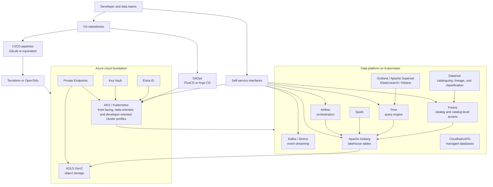

# Data Platform Architecture

## Platform Controls

- Multi-tenancy and RBAC
- Least privilege, identity, secrets management, network segmentation, and supply-chain integrity
- Naming standards, access policies, retention, catalog RBAC, lineage, and classification
- FinOps controls
- SLIs and SLOs for availability and data freshness
- Drift detection and Git reconciliation
- Versioned, reviewed, tested, and secured infrastructure code
- Runbooks, incident response, root-cause analysis, and safe upgrades with no data loss

## Self-Service Capabilities

- Kafka topics, schemas, and credentials
- Iceberg tables and catalogs
- Airflow connections
- Kubernetes namespaces
- Query access
